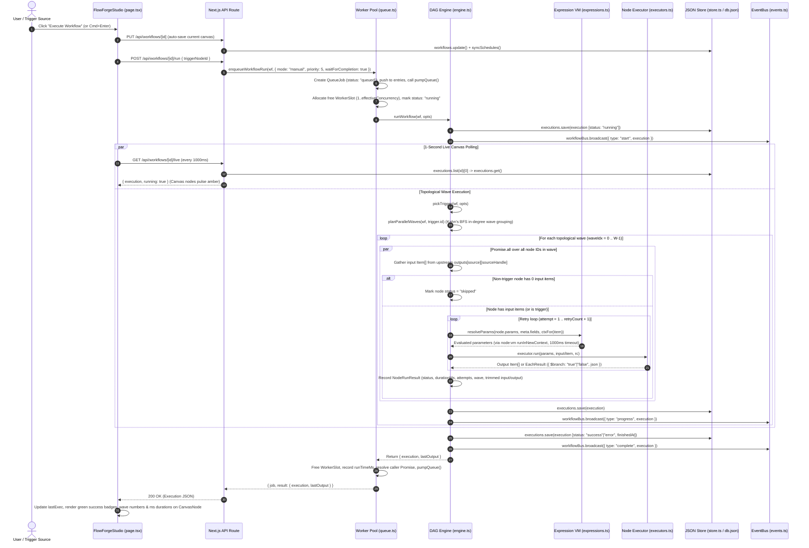

# 02 — System Architecture

> **Inspection Status:** `CONFIRMED`  
> **Architecture Pattern:** Monolithic Full-Stack Next.js 16 App Router Application with Global In-Memory Worker Pool, Background Polling/Cron Daemons, Sandboxed VM Expression Engine, and File-Backed JSON Persistence.

---

## 1. High-Level System Architecture Diagram (`CONFIRMED`)

```mermaid
flowchart TB
    subgraph Client ["Layer 1: Frontend Studio (Browser — React 19 + @xyflow/react)"]
        Studio["FlowForgeStudio (src/app/page.tsx)"]
        Canvas["ReactFlow DAG Canvas + CanvasNode.tsx"]
        Insp["Slide-Over Node Inspector (Inspector.tsx)"]
        QDash["Queue & Worker Pool Dashboard (QueueDashboard.tsx)"]
        AIModal["AI Workflow Builder Modal (Cmd+K)"]
        SecModal["Secrets Vault Modal"]
    end

    subgraph NextAPI ["Layer 2: Next.js 16 App Router API Layer (src/app/api/**)"]
        WfAPI["/api/workflows & /api/workflows/[id]"]
        RunAPI["/api/workflows/[id]/run & /run-parallel"]
        LiveAPI["/api/workflows/[id]/live & /api/executions"]
        QueueAPI["/api/queue (config, enqueue, burst, clear)"]
        HookAPI["/api/webhook/[...path]"]
        FormAPI["/api/forms/submit"]
        TgAPI["/api/telegram"]
        AIAPI["/api/ai-builder"]
        DBSecAPI["/api/db & /api/secrets"]
        SSEAPI["/api/events (SSE & Poll)"]
    end

    subgraph RuntimeCore ["Layer 3: Node.js Runtime Daemons & Execution Core (src/lib/**)"]
        Inst["src/instrumentation.ts (Boot Hook)"]
        Queue["Worker Pool & Priority Queue (queue.ts :: globalThis.__ffQueue)"]
        Sched["Cron Scheduler (scheduler.ts :: globalThis.__ffCronTimer)"]
        TgPoll["Telegram Poller (telegramPoller.ts :: globalThis.__ffTgTimer)"]
        Engine["Topological Wave Engine (engine.ts :: planParallelWaves + runWorkflow)"]
        Expr["VM Expression Sandbox (expressions.ts :: node:vm)"]
        Execs["20 Node Executors (executors.ts :: EXECUTORS)"]
        Bus["Workflow EventBus (events.ts :: globalThis.__ffEventBus)"]
    end

    subgraph Storage ["Layer 4: Local Persistence & Environment Sync"]
        Store["JSON Store Service (src/lib/store.ts)"]
        DBJson[("data/db.json\n(workflows, executions, secrets, records)")]
        JsonlFiles[("data/files/*.jsonl\n(parallel-websites.jsonl, top-users.jsonl)")]
        ExtEnv[("D:\\My n8n\\.env & .env.local\n+ local .env.local")]
    end

    subgraph External ["Layer 5: External Cloud & Local OS Providers"]
        Gemini["Google Gemini REST v1beta\n(2.5-flash -> 2.5-flash-lite -> 2.0-flash)"]
        OpenAI["OpenAI-Compatible LLM\n(/chat/completions)"]
        Telegram["Telegram Bot API\n(getMe, getUpdates, sendMessage)"]
        Email["Gmail SMTP (nodemailer)\n& Resend REST API"]
        Messaging["WhatsApp Graph v21.0,\nSlack & Discord Webhooks"]
        Payments["Razorpay v1 API &\nStripe v1 API"]
        GSheets["Google Sheets v4 API\n(RS256 Service Account JWT)"]
        WebSites["Target HTTP/REST Endpoints\n(parallel_web & http_request)"]
        OS["Local Shell (child_process.exec)\n& VM (node:vm)"]
    end

    Studio --> Canvas
    Studio --> Insp
    Studio --> QDash
    Studio --> AIModal
    Studio --> SecModal

    Studio -->|"CRUD / Save"| WfAPI
    Studio -->|"Manual Run / Batch"| RunAPI
    Studio -->|"1s Live Poll"| LiveAPI
    QDash -->|"1.5s Poll / Burst / Config"| QueueAPI
    AIModal -->|"Natural Language Prompt"| AIAPI
    SecModal -->|"Secrets & DB CRUD"| DBSecAPI
    Studio -->|"Start / Stop / Simulate"| TgAPI
    Studio -->|"Mini-App Submit"| FormAPI

    Inst -->|"Boot"| Sched
    Inst -->|"Boot"| TgPoll

    RunAPI --> Queue
    QueueAPI --> Queue
    HookAPI --> Queue

    Queue -->|"Allocates Worker Slot 1..N"| Engine
    Sched -->|"15s Cron Match"| Engine
    TgPoll -->|"4.5s getUpdates Match"| Engine
    FormAPI -->|"Direct Form Run"| Engine
    TgAPI -->|"Simulated Message"| TgPoll

    Engine --> Expr
    Engine --> Execs
    Engine -->|"Broadcast start/progress/complete"| Bus
    Bus --> SSEAPI

    WfAPI --> Store
    LiveAPI --> Store
    DBSecAPI --> Store
    AIAPI --> Store
    AIAPI --> Gemini
    FormAPI --> Store
    Engine --> Store
    Execs --> Store

    Store <--> DBJson
    Store <--|"Auto-syncs on read()"| ExtEnv
    Execs <--> JsonlFiles

    Execs --> Gemini
    Execs --> OpenAI
    Execs --> Telegram
    TgPoll --> Telegram
    Execs --> Email
    Execs --> Messaging
    Execs --> Payments
    Execs --> GSheets
    Execs --> WebSites
    Execs --> OS
```

---

## 2. Detailed Architectural Layers (`CONFIRMED`)

### 2.1 Layer 1: Frontend Visual Studio (`src/app/page.tsx` & `src/components/*`)
- **Single-Page Client Studio (`FlowForgeStudio` in `src/app/page.tsx:122-2260`):**
  - Renders a full-screen flex layout (`h-screen w-screen overflow-hidden bg-[#090a0f]`) divided into:
    1. **Collapsible Left Sidebar (`src/app/page.tsx:974-1214`):** Toggles between a 48px icon rail (`sidebarCollapsed = true` by default) and a 260px drawer with two tabs: `+ Nodes (20)` (searchable accordion grouped by `CATEGORIES`) and `Workflows (N)`.
    2. **Top Header Bar (`src/app/page.tsx:1219-1352`):** Inline workflow rename input, `Active`/`Draft` pill switch (persists immediately via `PUT /api/workflows/[id]`), `Secrets` button, `Auto-Layout (⌘L)`, `Export`/`Import` JSON buttons, `Save (⌘S)`, and `Execute Workflow (⌘↵)`.
    3. **Hero React Flow Canvas (`src/app/page.tsx:1355-1453`):** Renders `@xyflow/react` `<ReactFlow>` with custom `nodeTypes = { flowNode: CanvasNode }`, animated SVG edges color-coded by handle (`#10b981` for `true`, `#f43f5e` for `false`, `#6366f1` for `main` at `src/app/page.tsx:108-118`), `<Controls>`, collapsible `<MiniMap>`, floating top-center `AI Workflow Builder (⌘K)` trigger pill, and top-left execution summary banner.
    4. **Slide-Over Node Inspector (`src/components/Inspector.tsx:145-639`):** Mounted when `selectedWfNode` is non-null (`src/app/page.tsx:1456-1467`). Edits node `name`, `params`, `retryCount`, `retryDelayMs`, `continueOnError`, and displays syntax-highlighted input/output JSON items.
    5. **Bottom Telemetry & Dev Console Overlay Drawer (`src/app/page.tsx:1470-2004`):** Slides up (`360px` compact or `540px` tall) with 4 tabs:
       - `⚡ Queue & Worker Pool` (`QueueDashboard.tsx` + Multi-Workflow Parallel Batch + Parallel Website Health & Scraper).
       - `🗄️ Database Tables` (live viewer/clearer for `website_monitors`, `leads`, `orders`, `ai_logs`).
       - `📜 Execution History` (table of past runs; clicking any row loads its per-node telemetry onto the canvas via `inspectExecution()`).
       - `💬 Telegram & Forms` (2-way Telegram Bot listener toggle + message simulator + 4 interactive Mini-App Public Forms).
    6. **32px Footer Status Bar (`src/app/page.tsx:2008-2084`):** Displays live worker pool status (`⚡ Worker Pool: 6x Idle`), total DB record count, last run status, dock toggle button, and fullscreen toggle.

### 2.2 Layer 2: Next.js API Route Layer (`src/app/api/**`)
All backend endpoints are implemented as Next.js 16 App Router Route Handlers running on the Node.js runtime:
- **Synchronous vs. Asynchronous Execution Paths:**
  - `POST /api/workflows/[id]/run`, `POST /api/workflows/run-parallel`, `POST /api/queue` (`action: "enqueue"` with `wait !== false`, and `action: "burst"`), and `POST /api/webhook/[...path]` (when `respond === "lastNode"`) enqueue jobs into `src/lib/queue.ts` with `waitForCompletion: true` and await the Promise resolution before returning HTTP `200`.
  - `POST /api/webhook/[...path]` (when `respond === "immediately"`, the default) enqueues the job with `waitForCompletion: false` and immediately returns `202 Accepted` with `{ ok: true, jobId, status }` (`src/app/api/webhook/[...path]/route.ts:63-74`).
  - `POST /api/forms/submit` calls `runWorkflow()` directly (`src/app/api/forms/submit/route.ts:58-61`), bypassing `enqueueWorkflowRun`.
- **Long-Running Route Configuration:** Routes that execute workflows export `export const maxDuration = 300;` (`run/route.ts:5`, `run-parallel/route.ts:5`, `queue/route.ts:13`, `forms/submit/route.ts:5`, `webhook/[...path]/route.ts:5`).

### 2.3 Layer 3: Global Singleton Daemons & Execution Core (`src/lib/*`)
To survive Next.js hot-module replacement (HMR) and share state across API route invocations within the Node.js process, FlowForge attaches four singletons to `globalThis`:

| Singleton Property | File & Line | Type | Purpose |
| :--- | :--- | :--- | :--- |
| `globalThis.__ffQueue` | `src/lib/queue.ts:72, 78-87` | `InternalQueueStore` | Holds `mode` (`"parallel_pool"` \| `"sequential_fifo"`), `concurrency` (`6`), `seqCounter`, `entries` (`InternalJobEntry[]`, capped at `MAX_JOB_HISTORY = 120`), and `activeSlots` (`Map<workerId, jobId>`). |
| `globalThis.__ffEventBus` | `src/lib/events.ts:47-48` | `EventBus` | Holds active SSE `listeners` (`Set<Listener>`) and `recentEvents` ring buffer (last 50 `WorkflowEvent` items). |
| `globalThis.__ffCronJobs`, `__ffCronTimer`, `__ffLastMinute` | `src/lib/scheduler.ts:10-14` | `CronJob[]`, `Timeout`, `string` | Stores active `schedule_trigger` cron registrations and the 15-second `setInterval` ticker. |
| `globalThis.__ffTgRunning`, `__ffTgOffset`, `__ffTgTimer`, `__ffTgBotInfo`, `__ffTgLogs` | `src/lib/telegramPoller.ts:15-21` | Telegram poller state | Tracks Telegram `getUpdates` offset, 4.5-second `setInterval` timer, cached bot profile (`getMe`), and last 50 incoming message logs. |

> **Important Architectural Nuance (`CONFIRMED`):** While manual runs (`/api/workflows/[id]/run`), parallel batch runs (`/api/workflows/run-parallel`), queue actions (`/api/queue`), and webhooks (`/api/webhook/[...path]`) route through `enqueueWorkflowRun()` in `src/lib/queue.ts`, the **Cron Scheduler** (`src/lib/scheduler.ts:64`), **Telegram Poller** (`src/lib/telegramPoller.ts:56`), and **Public Form Submit** (`src/app/api/forms/submit/route.ts:58`) call `runWorkflow()` in `src/lib/engine.ts` directly. Consequently, cron, Telegram, and form runs are persisted in `data/db.json` (`executions`) and broadcast on `workflowBus`, but do not create entries in `globalThis.__ffQueue`.

---

## 3. End-to-End Execution Lifecycle & Data-Flow Diagram (`CONFIRMED`)



---

## 4. State Management & Data Synchronization (`CONFIRMED`)

### 4.1 Frontend State Architecture (`src/app/page.tsx`)
FlowForge uses localized React 19 hooks inside `FlowForgeStudio` (`src/app/page.tsx:122-240`) combined with `@xyflow/react` state hooks—no Redux, Zustand, or React Context providers are needed because the entire studio lives in a single coordinated workspace view:
1. **Graph State:** `useNodesState<Node<CanvasNodeData>>([])` and `useEdgesState<Edge>([])` (`src/app/page.tsx:125-126`).
   - Transformed from domain models via `toRfNodes(wfNodes, lastExec, running)` (`src/app/page.tsx:86-106`) and `toRfEdges(wfEdges)` (`src/app/page.tsx:108-118`).
   - Re-serialized back to domain models on save/export via `snapshotWorkflow()` (`src/app/page.tsx:393-412`).
2. **Real-Time Polling Loops (3 independent timers):**
   - **Current Workflow Live Sync (`1000ms`):** `useEffect` at `src/app/page.tsx:317-359` polls `GET /api/workflows/${currentWf.id}/live`. When a background run (e.g., Telegram message, cron schedule, or webhook) starts or finishes, the canvas automatically transitions to `running = true` and then updates `lastExec` and pops a toast notification (`⚡ ${modeLabel} automation executed live`).
   - **Footer Queue Badge Sync (`3000ms`):** `useEffect` at `src/app/page.tsx:289-314` polls `GET /api/queue` to keep the footer status bar (`queueBadge`) updated even when the bottom dock is closed.
   - **Queue Dashboard Active Poll (`1500ms`):** When the `QueueDashboard` tab is mounted, `useEffect` at `src/components/QueueDashboard.tsx:122-126` polls `GET /api/queue` every 1.5s to animate worker slots and job rows.
3. **Server-Sent Events Endpoint (`/api/events`):**
   - Implemented in `src/app/api/events/route.ts:1-72` over `workflowBus` (`src/lib/events.ts:1-48`). While available for external SSE consumers or `?mode=poll` clients, `src/app/page.tsx` relies on the 1-second `/api/workflows/[id]/live` polling loop for UI updates.

### 4.2 Backend Storage & Secret Resolution Architecture (`src/lib/store.ts`)
- **File-Backed Atomic Mutation Pattern (`src/lib/store.ts:71-117`):**
  - Every read (`read()`) checks if `data/db.json` exists; if not, it seeds `STARTER_WORKFLOWS` and `loadEnvSecrets()`.
  - If `data/db.json` exists, `read()` parses the JSON, ensures all 4 `STARTER_WORKFLOWS` exist by ID (prepending any missing starter workflow), and merges secrets from `EXTERNAL_ENV_FILES` with existing vault secrets.
  - Every write (`mutate(fn)`) performs `read() -> fn(db) -> fs.writeFileSync(DB_FILE, JSON.stringify(db, null, 2))`.
- **Retention Caps:**
  - `MAX_EXECUTIONS = 500` (`src/lib/store.ts:14, 166-169`): Oldest executions by `startedAt` are pruned on `executions.save()`.
  - `MAX_RECORDS = 2000` (`src/lib/store.ts:15, 222-224`): Oldest database records are sliced off on `dbTables.insert()`.
  - `MAX_STORED_ITEMS = 50` (`src/lib/engine.ts:8-9`): Per-node `input` and `output` item arrays inside `Execution.nodes[id]` are trimmed to 50 items before saving to prevent `data/db.json` bloat.
  - `MAX_JOB_HISTORY = 120` (`src/lib/queue.ts:75, 103-112`): In-memory queue retains all active/queued jobs plus the most recent finished jobs up to 120 total entries.
