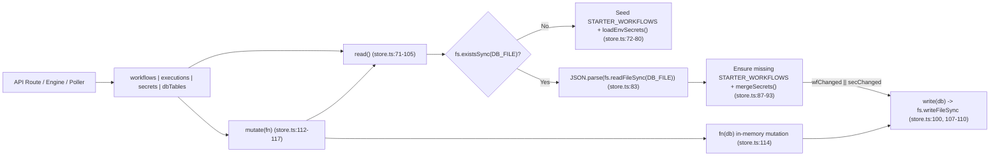

# 06 — Database & Persistence Map

> **Stage 1 Discovery Artifact** · **Project**: FlowForge (`C:\Users\srira\.gemini\antigravity\scratch\flowforge`)  
> **Scope**: Storage architecture, TypeScript data models, CRUD operations, retention policies, starter seeding, secret synchronization, file-system persistence, and comparison against the separate `D:\My n8n` prototype.

---

## 1. Storage Engine Architecture

FlowForge uses a **zero-dependency, synchronous file-backed JSON document store** rather than an external relational or NoSQL database server. All persistent application state is stored on local disk inside `C:\Users\srira\.gemini\antigravity\scratch\flowforge\data\`.

### 1.1 Primary Storage Locations

| Storage Artifact | Absolute / Resolved Path | Source Reference | Purpose & Format |
| :--- | :--- | :--- | :--- |
| **Data Directory** | `path.join(process.cwd(), "data")` (`.../flowforge/data`) | `src/lib/store.ts:6` | Root directory automatically created via `fs.mkdirSync(DATA_DIR, { recursive: true })` (`src/lib/store.ts:108`). |
| **Primary JSON Store** | `path.join(DATA_DIR, "db.json")` (`.../flowforge/data/db.json`) | `src/lib/store.ts:7` | Pretty-printed (`JSON.stringify(db, null, 2)`, UTF-8) JSON document containing four top-level arrays: `workflows`, `executions`, `secrets`, and `records` (`src/lib/store.ts:17-22`, `109`). Currently ~827 KB on disk. |
| **Workflow File Outputs** | `./data/files/*.jsonl`, `./data/files/*.txt` | `src/lib/executors.ts:649-672`, `src/lib/templates.ts:66, 296` | Local flat-file artifacts read/written by `read_file` and `write_file` workflow nodes (e.g., `data/files/parallel-websites.jsonl` and `data/files/top-users.jsonl`). |
| **External `.env` Secret Sources** | `D:\My n8n\.env`, `D:\My n8n\.env.local`, `<cwd>\.env.local`, `<cwd>\.env` | `src/lib/store.ts:8-13` | Read-only external dot-env files parsed and merged into `db.secrets` on every store `read()` (`src/lib/store.ts:24-69`, `93`). |

### 1.2 Core Read / Write / Mutate Lifecycle (`src/lib/store.ts`)



- **`read(): DB` (`src/lib/store.ts:71-105`)**:
  1. Checks `if (!fs.existsSync(DB_FILE))` (`line 72`). If missing, constructs a freshly seeded `DB` object using `structuredClone(STARTER_WORKFLOWS)` (`line 74`), empty `executions: []` (`line 75`), `secrets: loadEnvSecrets()` (`line 76`), and empty `records: []` (`line 77`), persists it immediately with `write(seeded)` (`line 79`), and returns it.
  2. If `data/db.json` exists, parses it via `JSON.parse(fs.readFileSync(DB_FILE, "utf8"))` (`line 83`).
  3. **Idempotent Starter Workflow Reconciliation (`lines 84-92`)**: Checks all IDs in `db.workflows` against `STARTER_WORKFLOWS` (`src/lib/templates.ts:3-309`). Any missing starter template is prepended (`existingWf.unshift(structuredClone(tmpl))`, `line 89`) and sets `wfChanged = true`.
  4. **Secret Synchronization (`line 93`)**: Calls `mergeSecrets(db.secrets ?? [])` to merge `.env` keys with stored secrets.
  5. If either `wfChanged || secChanged` is true, writes the updated state back to `data/db.json` (`line 100`).
  6. **Fallback Recovery (`lines 102-104`)**: If `JSON.parse` or `fs.readFileSync` throws (e.g., corrupted JSON), catches the exception and returns an in-memory fallback `{ workflows: [], executions: [], secrets: loadEnvSecrets(), records: [] }`.
- **`write(db: DB)` (`src/lib/store.ts:107-110`)**:
  - Ensures `DATA_DIR` exists via `fs.mkdirSync(DATA_DIR, { recursive: true })` (`line 108`).
  - Overwrites `DB_FILE` synchronously via `fs.writeFileSync(DB_FILE, JSON.stringify(db, null, 2), "utf8")` (`line 109`).
- **`mutate<T>(fn: (db: DB) => T): T` (`src/lib/store.ts:112-117`)**:
  - Executes a synchronous read-modify-write cycle: `const db = read(); const out = fn(db); write(db); return out;`.

---

## 2. Entity Schemas & TypeScript Interfaces

All core persistence interfaces are defined in `src/lib/types.ts` and aggregated in the internal `DB` interface in `src/lib/store.ts:17-22`.

### 2.1 Root `DB` Container (`src/lib/store.ts:17-22`)
```ts
interface DB {
  workflows: Workflow[];
  executions: Execution[];
  secrets: Secret[];
  records: DbRecord[];
}
```

### 2.2 `Workflow`, `WorkflowNode`, and `WorkflowEdge` (`src/lib/types.ts:39-65`)

| Entity | Field | Type | Required | Description & Source Line |
| :--- | :--- | :--- | :---: | :--- |
| **`Workflow`** | `id` | `string` | Yes | Unique identifier (`crypto.randomUUID()` or template slug like `"wf-parallel-multi-website"`, `types.ts:58`, `store.ts:127`). |
| | `name` | `string` | Yes | Human-readable title (`types.ts:59`). |
| | `active` | `boolean` | Yes | Controls whether background triggers (`schedule_trigger`, `webhook_trigger`, `telegram_trigger`) are active (`types.ts:60`). |
| | `nodes` | `WorkflowNode[]` | Yes | Array of DAG nodes (`types.ts:61`). |
| | `edges` | `WorkflowEdge[]` | Yes | Directed edges connecting nodes (`types.ts:62`). |
| | `createdAt` | `string` | Yes | ISO-8601 creation timestamp (`types.ts:63`). |
| | `updatedAt` | `string` | Yes | ISO-8601 last-modified timestamp (`types.ts:64`). |
| **`WorkflowNode`** | `id` | `string` | Yes | Node instance ID within the workflow (`types.ts:40`). |
| | `type` | `string` | Yes | Node type key matching `NODE_MAP` / `EXECUTORS` (e.g., `"manual_trigger"`, `"parallel_web"`, `"gemini"`, `"db_query"`, `types.ts:41`). |
| | `name` | `string` | Yes | Display label on canvas and key in `rc.nodeOutputs[node.name]` (`types.ts:42`, `engine.ts:184`). |
| | `position` | `{ x: number; y: number }` | Yes | 2D canvas coordinates for `@xyflow/react` (`types.ts:43`). |
| | `params` | `Record<string, unknown>` | Yes | Node configuration dictionary; supports `{{ ... }}` expressions (`types.ts:44`). |
| | `retryCount` | `number` | No | Optional auto-retry count on node failure (`0..5`, `types.ts:45`, `engine.ts:144`). |
| | `retryDelayMs` | `number` | No | Optional delay in ms between retries (default `500`, `types.ts:46`, `engine.ts:145`). |
| | `continueOnError` | `boolean` | No | If `true`, emits fallback error item instead of halting execution (`types.ts:47`, `engine.ts:208-221`). |
| **`WorkflowEdge`** | `id` | `string` | Yes | Edge identifier (`types.ts:51`). |
| | `source` | `string` | Yes | Upstream `WorkflowNode.id` (`types.ts:52`). |
| | `target` | `string` | Yes | Downstream `WorkflowNode.id` (`types.ts:53`). |
| | `sourceHandle` | `string \| null` | No | Output branch handle (`"main"` default, or `"true"` / `"false"` on `if` nodes, `types.ts:54`, `engine.ts:137`). |

### 2.3 `Execution` and `NodeRunResult` (`src/lib/types.ts:67-90`)

| Entity | Field | Type | Required | Description & Source Line |
| :--- | :--- | :--- | :---: | :--- |
| **`Execution`** | `id` | `string` | Yes | UUID generated per workflow run (`crypto.randomUUID()`, `types.ts:81`, `engine.ts:87`). |
| | `workflowId` | `string` | Yes | Foreign key referencing `Workflow.id` (`types.ts:82`). |
| | `workflowName` | `string` | Yes | Snapshot of `Workflow.name` at execution time (`types.ts:83`). |
| | `mode` | `"manual" \| "schedule" \| "webhook" \| "telegram" \| "form" \| "parallel_batch"` | Yes | Trigger mode that initiated the execution (`types.ts:84`). |
| | `status` | `"running" \| "success" \| "error"` (`RunStatus`) | Yes | Overall execution status (`types.ts:67, 85`). |
| | `startedAt` | `string` | Yes | ISO-8601 start timestamp (`types.ts:86`). |
| | `finishedAt` | `string` | No | ISO-8601 completion timestamp (`types.ts:87`, `engine.ts:254`). |
| | `error` | `string` | No | Top-level error message if `status === "error"` (`types.ts:88`, `engine.ts:252`). |
| | `nodes` | `Record<string, NodeRunResult>` | Yes | Map of `nodeId -> NodeRunResult` telemetry (`types.ts:89`). |
| **`NodeRunResult`** | `status` | `"success" \| "error" \| "skipped"` | Yes | Per-node execution outcome (`types.ts:70`). |
| | `startedAt` | `string` | Yes | ISO-8601 start time for the node (`types.ts:71`). |
| | `durationMs` | `number` | Yes | Wall-clock execution time in milliseconds (`types.ts:72`). |
| | `attempts` | `number` | No | Number of execution attempts made (including retries, `types.ts:73`, `engine.ts:190`). |
| | `wave` | `number` | No | Zero-based topological parallel wave index (`types.ts:74`, `engine.ts:191`). |
| | `input` | `Item[]` | No | Input items passed into the node, capped at `MAX_STORED_ITEMS = 50` (`types.ts:1, 75`, `engine.ts:8-9, 192`). |
| | `output` | `Item[] \| Record<string, Item[]>` | No | Output items (array for single-output nodes, handle map for multi-output nodes like `if`), capped at 50 items per handle (`types.ts:76`, `engine.ts:193-195`). |
| | `error` | `string` | No | Error message if node failed or continued on error (`types.ts:77`). |

### 2.4 `Secret` (`src/lib/types.ts:92-96`)
```ts
export interface Secret {
  key: string;       // Normalized UPPER_SNAKE_CASE identifier (e.g., "GEMINI_API_KEY")
  value: string;     // Raw secret string in db.json; masked in GET /api/secrets (src/app/api/secrets/route.ts:4)
  updatedAt: string; // ISO-8601 timestamp
}
```

### 2.5 `DbRecord` (`src/lib/types.ts:98-103`)
```ts
export interface DbRecord {
  id: string;                    // Generated as `rec_${crypto.randomUUID().slice(0, 8)}` (src/lib/store.ts:216)
  table: string;                 // Logical table name (e.g., "website_monitors", "leads", "orders", "ai_logs")
  data: Record<string, unknown>; // Arbitrary JSON row payload
  createdAt: string;             // ISO-8601 insertion timestamp
}
```

---

## 3. CRUD Operations, Retention Caps & Seeding (`src/lib/store.ts`)

### 3.1 `workflows` Repository (`src/lib/store.ts:120-152`)

| Method | Signature | Behavior & Side Effects | API Route Caller |
| :--- | :--- | :--- | :--- |
| **`list()`** | `() => Workflow[]` | Reads DB and sorts workflows descending by `updatedAt` (`b.updatedAt.localeCompare(a.updatedAt)`, `line 121`). | `GET /api/workflows` (`src/app/api/workflows/route.ts:5`), `scheduler.ts:75`, `telegramPoller.ts:44` |
| **`get(id)`** | `(id: string) => Workflow \| undefined` | Finds workflow by `id` (`line 122`). | `GET /api/workflows/[id]` (`src/app/api/workflows/[id]/route.ts:9`), `POST /api/workflows/[id]/run` |
| **`create(name, custom?)`** | `(name: string, custom?: Partial<Workflow>) => Workflow` | Creates a new `Workflow` with `id: custom?.id ?? crypto.randomUUID()`, `active: custom?.active ?? false`, default single `manual_trigger` node at `{ x: 80, y: 200 }` if `custom?.nodes` omitted, and prepends via `db.workflows.unshift(wf)` (`lines 123-139`). | `POST /api/workflows` (`src/app/api/workflows/route.ts:10`), `POST /api/ai-builder` (`src/app/api/ai-builder/route.ts:264, 279`) |
| **`update(id, patch)`** | `(id: string, patch: Partial<Omit<Workflow, "id" \| "createdAt">>) => Workflow \| undefined` | Mutates matching workflow in-place via `Object.assign(wf, patch, { updatedAt: new Date().toISOString() })` (`lines 140-146`). | `PUT /api/workflows/[id]` (`src/app/api/workflows/[id]/route.ts:16`, followed by `syncSchedules()`) |
| **`remove(id)`** | `(id: string) => void` | Filters out workflow from `db.workflows` **and** cascade-deletes its execution history (`db.executions = db.executions.filter((e) => e.workflowId !== id)`, `lines 147-151`). | `DELETE /api/workflows/[id]` (`src/app/api/workflows/[id]/route.ts:28`, followed by `syncSchedules()`) |

### 3.2 `executions` Repository (`src/lib/store.ts:155-175`)

| Method | Signature | Behavior & Retention Cap | API Route / Engine Caller |
| :--- | :--- | :--- | :--- |
| **`list(workflowId?)`** | `(workflowId?: string) => Execution[]` | Filters by `workflowId` if provided and sorts newest-first (`b.startedAt.localeCompare(a.startedAt)`, `lines 156-159`). | `GET /api/executions` (`src/app/api/executions/route.ts:14`), `GET /api/workflows/[id]/live` (`src/app/api/workflows/[id]/live/route.ts:9`) |
| **`get(id)`** | `(id: string) => Execution \| undefined` | Returns full `Execution` including `nodes` telemetry (`line 160`). | `GET /api/executions?id=...` (`src/app/api/executions/route.ts:8`), `GET /api/workflows/[id]/live` (`line 14`) |
| **`save(exec)`** | `(exec: Execution) => void` | Upserts `exec` by `id` (`lines 163-165`). Enforces **`MAX_EXECUTIONS = 500`** (`line 14`): when `db.executions.length > 500`, sorts ascending by `startedAt` and retains the newest 500 via `.slice(-MAX_EXECUTIONS)` (`lines 166-169`). Also note `engine.ts:8` caps per-node stored `input`/`output` arrays at **`MAX_STORED_ITEMS = 50`**. | `runWorkflow()` in `src/lib/engine.ts:95, 237, 255` (on start, after each wave, and on completion) |
| **`clear(workflowId?)`** | `(workflowId?: string) => void` | Clears executions for a specific `workflowId`, or empties `db.executions = []` if omitted (`lines 171-174`). | `DELETE /api/executions` (`src/app/api/executions/route.ts:23`) |

### 3.3 `secrets` Repository (`src/lib/store.ts:178-192`)

| Method | Signature | Behavior | Caller |
| :--- | :--- | :--- | :--- |
| **`list()`** | `() => Secret[]` | Returns array of `Secret` objects (`line 179`). Masked to `abc••••••••xyz` by `GET /api/secrets` (`src/app/api/secrets/route.ts:4-7`). | `GET /api/secrets` |
| **`map()`** | `() => Record<string, string>` | Converts `Secret[]` into a key-value dictionary (`Object.fromEntries(...)`, `line 180`). | `engine.ts:111`, `telegramPoller.ts:72`, `ai-builder/route.ts:212`, `telegram/route.ts:29` |
| **`set(key, value)`** | `(key: string, value: string) => void` | Updates existing secret or pushes a new entry with current `updatedAt` (`lines 181-187`). `POST /api/secrets` sanitizes keys via `.trim().toUpperCase().replace(/[^A-Z0-9_]/g, "_")` (`src/app/api/secrets/route.ts:12`). | `POST /api/secrets` |
| **`remove(key)`** | `(key: string) => void` | Removes key from `db.secrets` (`lines 188-191`). *(Note: if the key exists in one of the `EXTERNAL_ENV_FILES`, the next `read()` will re-import it via `mergeSecrets`!)* | `DELETE /api/secrets` |

### 3.4 `dbTables` Repository (`src/lib/store.ts:195-231`)

FlowForge provides a built-in logical multi-table document store inside `db.records`:

- **Default Logical Tables (`src/lib/store.ts:197-202`)**:
  `dbTables.tables()` pre-initializes counts to `0` for four built-in tables before counting records in `db.records`:
  1. `website_monitors` (used by `wf-parallel-multi-website` and `parallel-websites` form)
  2. `leads` (used by `lead-capture` form)
  3. `orders` (used by `order-checkout` form)
  4. `ai_logs` (used by `wf-telegram-bot-responder` and `ask-ai` form)
  *(Any custom table name passed to `dbTables.insert(table, data)` is also dynamically tallied in `counts` at `line 204`.)*
- **`list(table?, limit = 100)` (`lines 208-212`)**: Filters `db.records` by `table` (or returns all if omitted), sorts descending by `createdAt`, and slices up to `limit` (default `100`).
- **`insert(table, data)` (`lines 213-226`)**: Creates a `DbRecord` with `id: "rec_" + crypto.randomUUID().slice(0, 8)`, defaults blank table names to `"default"`, appends to `db.records`, and enforces **`MAX_RECORDS = 2000`** (`line 15`) via `db.records = db.records.slice(-MAX_RECORDS)` (`lines 222-224`).
- **`clear(table?)` (`lines 227-230`)**: Deletes records matching `table`, or clears all `db.records = []` if `table` is undefined.
- **Callers**: `GET / POST / DELETE /api/db` (`src/app/api/db/route.ts:4-25`), `db_query` executor (`src/lib/executors.ts:282-299`), and `POST /api/forms/submit` (`src/app/api/forms/submit/route.ts:23-26`).

---

## 4. Starter Workflow Auto-Seeding (`src/lib/templates.ts` & `src/lib/store.ts`)

`STARTER_WORKFLOWS` (`src/lib/templates.ts:3-309`) defines 4 pre-built, active workflows (`active: true`):

| Workflow ID | Name | Nodes & Topology (`src/lib/templates.ts`) |
| :--- | :--- | :--- |
| `wf-parallel-multi-website` | `🌐 Parallel 5-Website Live Monitor → DB + Gemini AI + Telegram + Gmail` | `pw-trigger` (`manual_trigger`) → `pw-web` (`parallel_web`) → fan-out to `pw-db` (`db_query` into `website_monitors`), `pw-ai` (`gemini`), `pw-file` (`write_file` to `./data/files/parallel-websites.jsonl`); `pw-ai` fans out to `pw-tg` (`telegram`) and `pw-gmail` (`email`). (`lines 4-111`) |
| `wf-live-ai-telegram-gmail` | `⚡ Live: Gemini AI → Telegram Bot + Gmail Dispatch (Active Keys)` | `l-trigger` (`manual_trigger`) → `l-gemini` (`gemini`) → parallel fan-out to `l-tg` (`telegram`) and `l-gmail` (`email`). (`lines 113-178`) |
| `wf-telegram-bot-responder` | `💬 2-Way Telegram Bot Listener → Parallel Web Check + Gemini AI Reply` | `tb-trig` (`telegram_trigger`) → `tb-ai` (`gemini`) → parallel fan-out to `tb-reply` (`telegram`) and `tb-db` (`db_query` into `ai_logs`). (`lines 180-236`) |
| `wf-demo-api-pipeline` | `🚀 Live Demo: API Fetch → IF Filter → JS Transform → File Log` | `n-trigger` (`manual_trigger`) → `n-http` (`http_request` to JSONPlaceholder `/users`) → `n-if` (`if` `id < 4`) → `true` branch to `n-code` (`code`) → `n-write` (`write_file` to `./data/files/top-users.jsonl`). (`lines 238-308`) |

On every `read()` (`src/lib/store.ts:85-92`), if any of these 4 IDs is missing from `data/db.json`, it is automatically re-inserted at the top of `db.workflows`. Currently, `data/db.json` contains **6 workflows** (the 4 starter workflows plus 2 user/AI-created workflows), **70 executions**, and **50 records**.

---

## 5. External `.env` Synchronization & Secret Keys Inventory

### 5.1 Synchronization Precedence (`src/lib/store.ts:8-13, 24-69`)

`loadEnvSecrets()` (`src/lib/store.ts:49-59`) iterates through `EXTERNAL_ENV_FILES` in order, calling `parseDotEnvFile(fp)` and merging via `Object.assign(merged, ...)`:
1. `D:\My n8n\.env` (`line 9`)
2. `D:\My n8n\.env.local` (`line 10`)
3. `path.join(process.cwd(), ".env.local")` (`C:\Users\srira\.gemini\antigravity\scratch\flowforge\.env.local`, `line 11`)
4. `path.join(process.cwd(), ".env")` (`line 12`)

**Alias Mapping (`src/lib/store.ts:54-55`)**:
- If `GMAIL_USER` is present and `SMTP_USER` is not set, `merged.SMTP_USER = merged.GMAIL_USER`.
- If `GMAIL_APP_PASSWORD` is present and `SMTP_PASS` is not set, `merged.SMTP_PASS = merged.GMAIL_APP_PASSWORD`.

**Merge Order with `db.json` (`src/lib/store.ts:61-69`)**:
- `mergeSecrets(existing)` first populates a `Map` with `envSecrets` (`line 64`), and then overlays `existing` secrets from `data/db.json` where `s.value` is non-empty (`line 65`).
- Empty values (`val === ""`) in `.env` files are skipped by `parseDotEnvFile` (`line 39`).

### 5.2 Key Names Present Across `.env` Files & `data/db.json` (Values Redacted)

| Secret / Env Key Name | Present in `D:\My n8n\.env` & `.env.local` | Synced into `data/db.json` (`secrets[]`) | Reason / Usage in FlowForge |
| :--- | :---: | :---: | :--- |
| `GEMINI_API_KEY` | Yes (non-empty) | Yes | Used by `gemini` node (`executors.ts:372`) & AI Builder (`ai-builder/route.ts:213`). |
| `OPENAI_API_KEY` | Yes (empty in `.env`) | No (skipped because empty) | Used by `openai_chat` node (`nodes.ts:291`). |
| `ANTHROPIC_API_KEY` | Yes (empty in `.env`) | No (skipped because empty) | Defined in `.env` template; not referenced in FlowForge executors. |
| `OLLAMA_BASE_URL` | Yes (non-empty) | Yes | Local LLM base URL (`http://localhost:11434`). |
| `RESEND_API_KEY` | Yes (non-empty) | Yes | Used by `email` node when `provider === "resend"` (`executors.ts:526`). |
| `GMAIL_USER` | Yes (non-empty) | Yes | Used by `email` node (`gmail_smtp`) as SMTP user & recipient (`executors.ts:539-550`). |
| `GMAIL_APP_PASSWORD` | Yes (non-empty) | Yes | Used by `email` node (`gmail_smtp`) as SMTP password (`executors.ts:545`). |
| `SMTP_USER` | Auto-aliased (`store.ts:54`) | Yes | Auto-derived from `GMAIL_USER` in `loadEnvSecrets()`. |
| `SMTP_PASS` | Auto-aliased (`store.ts:55`) | Yes | Auto-derived from `GMAIL_APP_PASSWORD` in `loadEnvSecrets()`. |
| `DEFAULT_FROM_EMAIL` | Yes (non-empty) | Yes | Default `from` address for Resend email dispatch (`nodes.ts:397`). |
| `TELEGRAM_BOT_TOKEN` | Yes (non-empty) | Yes | Used by `telegramPoller.ts:73` and `telegram` node (`executors.ts:465`). |
| `TELEGRAM_CHAT_ID` | Yes (non-empty) | Yes | Default chat target for `telegram` and `telegram_trigger` (`executors.ts:144, 466`). |
| `DISCORD_WEBHOOK_URL` | Yes (empty in `.env`) | No (skipped because empty) | Used by `discord` node (`nodes.ts:369`). |
| `DB_TYPE`, `MYSQL_HOST`, `MYSQL_PORT`, `MYSQL_USER`, `MYSQL_DATABASE`, `REDIS_URL`, `NEXT_PUBLIC_APP_URL`, `NODE_ENV` | Yes (non-empty) | Yes | Legacy config keys carried over from `D:\My n8n\.env`; **not used** by FlowForge's `store.ts` (which uses `data/db.json`). |
| `MYSQL_PASSWORD`, `DATABASE_URL` | Yes (empty in `.env`) | No (skipped because empty) | Legacy database keys from `D:\My n8n\.env`. |

---

## 6. Comparison: Active `flowforge` App vs. Separate `D:\My n8n` Prototype

During discovery, two distinct directories were inspected:

| Dimension | Active Project (`C:\Users\srira\.gemini\antigravity\scratch\flowforge`) | Separate Prototype (`D:\My n8n`) |
| :--- | :--- | :--- |
| **Package Name & Version** | `"name": "flowforge"`, `"version": "0.1.0"`, Next.js `16.4.6`, React `19.3.0` (`package.json:2-18`) | `"name": "flowcraft"`, `"version": "0.1.0"`, Next.js `16.4.3`, React `19.3.0` (`D:\My n8n\package.json:2-18`) |
| **Database Driver Dependencies** | None — pure Node.js `node:fs` JSON persistence in `src/lib/store.ts` (`data/db.json`) | Lists `"mysql2": "^3.24.6"` in `D:\My n8n\package.json:14` and defines `DB_TYPE`, `MYSQL_HOST`, `MYSQL_PORT`, `MYSQL_USER`, `MYSQL_DATABASE`, `REDIS_URL` in `D:\My n8n\.env` |
| **Canvas Library** | `@xyflow/react` (`^12.12.1`, `package.json:13`) | Custom canvas + `canvas-confetti` (`D:\My n8n\package.json:12`) |
| **Cross-Project Coupling** | `flowforge/src/lib/store.ts:9-10` explicitly hardcodes `"D:\\My n8n\\.env"` and `"D:\\My n8n\\.env.local"` in `EXTERNAL_ENV_FILES` to share credentials without duplicating `.env` setup. | Acts as the upstream credential source on the local Windows machine (`D:\My n8n\.env`). |
