# 07 — AI System Map

> **Scope & Provenance**: Exhaustive read-only discovery of all Artificial Intelligence integrations, LLM execution pipelines, prompt engineering/context-injection mechanics, fallback cascades, natural-language workflow synthesis, and architectural boundaries in **FlowForge** (`C:\Users\srira\.gemini\antigravity\scratch\flowforge`). Every claim is backed by exact file paths, function names, and line numbers. No secret values or tokens are exposed.

---

## 1. AI Subsystem Architecture Overview

FlowForge integrates AI in **two distinct architectural layers**:
1. **Runtime Workflow Execution Layer (`src/lib/nodes.ts` & `src/lib/executors.ts`)**:
   - **`gemini` Node (`Gemini AI`)**: First-class Google Gemini REST `v1beta` integration with multi-model fallback cascade, real-world IST context injection, optional JSON output mode, metadata forwarding (`chatId`, `fromName`), and adaptive resilience fallback.
   - **`openai_chat` Node (`OpenAI-compatible LLM`)**: Universal OpenAI `/chat/completions` REST client supporting OpenAI, OpenRouter, Groq, Ollama, and any compatible endpoint.
2. **Design-Time AI Workflow Architect Layer (`src/app/api/ai-builder/route.ts`)**:
   - **`POST /api/ai-builder`**: Converts natural language prompts (English or Tanglish) into executable, auto-laid-out multi-node DAG workflows (`WorkflowNode[]` + `WorkflowEdge[]`) using Gemini `responseMimeType: "application/json"` with a deterministic keyword-heuristic synthesizer (`fallbackSynthesize`) when API keys are absent or upstream LLM calls fail.

```mermaid
flowchart TB
    subgraph DesignTime["1. Design-Time: AI Workflow Builder (src/app/api/ai-builder/route.ts)"]
        Prompt["User Natural Language Prompt<br/>(English / Tanglish)"] --> CheckKey{"GEMINI_API_KEY<br/>Available? (L212-215)"}
        CheckKey -->|Yes| BuilderCascade["Model Cascade (L216)<br/>1. gemini-2.5-flash<br/>2. gemini-2.5-flash-lite<br/>3. gemini-2.0-flash"]
        BuilderCascade -->|HTTP 200 + Valid JSON >=2 nodes| ValidateDAG["Filter NODE_MAP & Merge defaultParams<br/>(L244-262)"]
        BuilderCascade -->|Error / Timeout 12s / Invalid| FallbackSynth["fallbackSynthesize(prompt)<br/>Keyword Heuristic DAG Builder (L71-204)"]
        CheckKey -->|No| FallbackSynth
        ValidateDAG --> AutoLayout["layoutGraph(nodes, edges)<br/>Topological Column Auto-Layout (L45-69)"]
        FallbackSynth --> PersistWF["workflows.create(...)<br/>Persist Active Workflow (L264, L279)"]
        AutoLayout --> PersistWF
    end

    subgraph Runtime["2. Runtime: Workflow Execution Engine (src/lib/executors.ts)"]
        ItemIn["Incoming Item<br/>{ json: { ... } }"] --> ExprResolve["resolveParams() in src/lib/expressions.ts<br/>Resolves {{ $json }}, {{ $secrets }}, etc. (L64-95)"]
        ExprResolve --> NodeSwitch{"AI Node Type"}
        NodeSwitch -->|gemini| ContextInject["Runtime Context Injection (L376-392)<br/>IST Date/Time + User Identity into<br/>systemInstruction & user prompt"]
        ContextInject --> ExecCascade["Gemini Model Cascade (L373-374, L394)<br/>1. Preferred (default: gemini-2.5-flash)<br/>2. gemini-2.5-flash-lite<br/>3. gemini-2.0-flash<br/>4. gemini-flash-latest"]
        ExecCascade -->|Success| ParseOut["Output Parser (L408-426)<br/>Text extraction + optional JSON.parse<br/>+ chatId/fromName + usageMetadata"]
        ExecCascade -->|All 4 Fail / 503 Spike| AdaptiveFallback["Adaptive Summary Fallback (L432-440)<br/>model: 'gemini-adaptive-fallback'"]
        NodeSwitch -->|openai_chat| OpenAICall["POST {baseUrl}/chat/completions (L443-460)<br/>Bearer Auth + system/user messages"]
    end
```



---

## 2. Implemented AI Providers

### 2.1 Google Gemini Provider (`gemini` Node & AI Builder)

- **Node Catalogue Definition**: `src/lib/nodes.ts`, `NODE_DEFS` entry at lines `268–281`.
  - `type`: `"gemini"`
  - `label`: `"Gemini AI"`
  - `description`: `"Generate text with Google Gemini"`
  - `category`: `"AI"`
  - `color`: `"#8b5cf6"`, `icon`: `"Sparkles"`
- **Field Schema (`src/lib/nodes.ts:274–280`)**:
  | Field Key | Label | Type | Default Value | Required |
  | :--- | :--- | :--- | :--- | :--- |
  | `apiKey` | API key | `text` | `"{{ $secrets.GEMINI_API_KEY }}"` | Yes (enforced via `need(p, "apiKey", "prompt")` at `src/lib/executors.ts:372`) |
  | `model` | Model | `text` | `"gemini-2.5-flash"` | No (falls back to `"gemini-2.5-flash"` at `src/lib/executors.ts:373`) |
  | `system` | System instruction | `textarea` | `"You are a helpful assistant."` | No |
  | `prompt` | Prompt | `textarea` | `"Summarize: {{ JSON.stringify($json) }}"` | Yes (`required: true` at `src/lib/nodes.ts:278` & `need()` at `src/lib/executors.ts:372`) |
  | `jsonMode` | Return JSON | `boolean` | `false` | No |

- **REST Endpoint & Protocol (`src/lib/executors.ts:396–407`)**:
  - **URL**: `https://generativelanguage.googleapis.com/v1beta/models/${encodeURIComponent(model)}:generateContent`
  - **HTTP Method**: `POST`
  - **Authentication Header**: `{ "x-goog-api-key": s(p.apiKey) }` (sent via header, never leaked in query parameters).
  - **Transport Wrapper**: Uses the internal `request()` helper (`src/lib/executors.ts:38–58`), which automatically sets `content-type: application/json`, serializes `json` payload, enforces `AbortSignal.timeout(60_000)` (60 seconds), parses JSON responses, and throws structured `HTTP <status> from <host>: <body_slice_500>` errors on non-2xx responses.
  - **Request Payload Structure (`src/lib/executors.ts:401–405`)**:
    ```json
    {
      "systemInstruction": { "parts": [{ "text": "<finalSystem>" }] },
      "contents": [{ "role": "user", "parts": [{ "text": "<userPromptWithFacts>" }] }],
      "generationConfig": { "responseMimeType": "application/json" } // Included ONLY when p.jsonMode is truthy (L404)
    }
    ```

### 2.2 OpenAI-Compatible Provider (`openai_chat` Node)

- **Node Catalogue Definition**: `src/lib/nodes.ts`, `NODE_DEFS` entry at lines `282–296`.
  - `type`: `"openai_chat"`
  - `label`: `"OpenAI-compatible LLM"`
  - `description`: `"OpenAI, OpenRouter, Groq, Ollama…"`
  - `category`: `"AI"`
  - `color`: `"#8b5cf6"`, `icon`: `"Bot"`
- **Field Schema (`src/lib/nodes.ts:289–295`)**:
  | Field Key | Label | Type | Default Value | Required |
  | :--- | :--- | :--- | :--- | :--- |
  | `baseUrl` | Base URL | `text` | `"https://api.openai.com/v1"` | Yes (`need(p, "baseUrl", "model", "prompt")` at `src/lib/executors.ts:446`) |
  | `apiKey` | API key | `text` | `"{{ $secrets.OPENAI_API_KEY }}"` | Optional in `need()` ( enables local unauthenticated endpoints like Ollama) |
  | `model` | Model | `text` | `"gpt-4o-mini"` | Yes (`need()` at `src/lib/executors.ts:446`) |
  | `system` | System prompt | `textarea` | `"You are a helpful assistant."` | No |
  | `prompt` | Prompt | `textarea` | `"{{ $json.text }}"` | Yes (`required: true` at `src/lib/nodes.ts:294` & `need()` at `src/lib/executors.ts:446`) |

- **REST Endpoint & Protocol (`src/lib/executors.ts:443–460`)**:
  - **Execution Mode**: `mode: "each"` (runs once per incoming `Item`).
  - **URL Construction**: `${s(p.baseUrl).replace(/\/$/, "")}/chat/completions` (`src/lib/executors.ts:447`), stripping trailing slashes before appending `/chat/completions`.
  - **Authentication Header**: `s(p.apiKey) ? { authorization: \`Bearer ${s(p.apiKey)}\` } : {}` (`src/lib/executors.ts:449`).
  - **Request Payload (`src/lib/executors.ts:450–456`)**:
    ```json
    {
      "model": "<p.model>",
      "messages": [
        { "role": "system", "content": "<p.system>" }, // Conditionally included only if s(p.system) is non-empty (L453)
        { "role": "user", "content": "<p.prompt>" }
      ]
    }
    ```
  - **Output Structure (`src/lib/executors.ts:458`)**:
    Returns `{ text: data.choices?.[0]?.message?.content ?? "", usage: data.usage }`.
  - **Differences vs. `gemini` Node**:
    - `openai_chat` does **not** inject `runtimeContext` (IST date/time or user facts).
    - `openai_chat` does **not** implement a multi-model fallback cascade or adaptive fallback (errors propagate to `runWorkflow` in `src/lib/engine.ts:199–234`, where node-level `retryCount` and `continueOnError` apply).
    - `openai_chat` does **not** automatically forward `item.json.chatId` or `item.json.fromName`.

---

## 3. Model Configurations & Multi-Model Fallback Cascade

FlowForge implements two distinct Gemini model cascades to survive upstream HTTP 429 rate-limits, 503 capacity spikes, or model deprecations:

### 3.1 Runtime `gemini` Node Cascade (`src/lib/executors.ts:373–440`)

1. **Candidate List Construction (`src/lib/executors.ts:373–374`)**:
   ```ts
   const preferred = s(p.model) || "gemini-2.5-flash";
   const candidates = [...new Set([preferred, "gemini-2.5-flash-lite", "gemini-2.0-flash", "gemini-flash-latest"])];
   ```
   - Deduplicates via `Set` so if `p.model` is already `"gemini-2.5-flash"` (the default), the exact 4-step cascade order is:
     1. `gemini-2.5-flash` (or user-configured custom model first)
     2. `gemini-2.5-flash-lite`
     3. `gemini-2.0-flash`
     4. `gemini-flash-latest`
   - If the user specifies a custom model (e.g., `gemini-2.5-pro`), the cascade becomes 5 steps: `["gemini-2.5-pro", "gemini-2.5-flash-lite", "gemini-2.0-flash", "gemini-flash-latest"]`.

2. **Sequential Trial Loop (`src/lib/executors.ts:394–431`)**:
   - Iterates `for (const model of candidates)`.
   - Calls `request(...)` with a 60-second timeout (`src/lib/executors.ts:45`).
   - Extracts `const text = data.candidates?.[0]?.content?.parts?.map((x) => x.text ?? "").join("") ?? "";` (`src/lib/executors.ts:408`).
   - **Success Condition (`src/lib/executors.ts:409`)**: If `text` is non-empty (`if (text)`), immediately returns the structured output object including `model` (recording which model in the cascade actually succeeded).
   - **Failure / Empty Condition (`src/lib/executors.ts:428–430`)**: Any HTTP error, timeout, or empty `text` response is caught (`catch { // Try next candidate model }`) and advances immediately to the next candidate model.

3. **Stage 5: Adaptive Summary Fallback (`src/lib/executors.ts:432–440`)**:
   - If all candidate models throw or return empty text (e.g., during an upstream 503 capacity spike or network outage), the `gemini` executor **never throws** once `apiKey` and `prompt` are present.
   - Instead, it sanitizes the prompt (`const cleanPrompt = s(p.prompt).replace(/\s+/g, " ").slice(0, 160);` at line `433`) and returns a deterministic live fallback payload (`lines 434–440`):
     ```ts
     return {
       text: `⚡ [Gemini Live Summary]\n• Today: ${realDate}\n• Status: Active & healthy\n• Query: ${cleanPrompt}`,
       model: "gemini-adaptive-fallback",
       isLive: true,
       chatId: item?.json?.chatId,
       fromName: item?.json?.fromName,
     };
     ```

### 3.2 Design-Time AI Builder Cascade (`src/app/api/ai-builder/route.ts:215–278`)

- When `POST /api/ai-builder` is called and `apiKey` (`sec.GEMINI_API_KEY || process.env.GEMINI_API_KEY`, line `213`) is present:
  - Loops over a **3-model cascade** at `src/app/api/ai-builder/route.ts:216`:
    1. `"gemini-2.5-flash"`
    2. `"gemini-2.5-flash-lite"`
    3. `"gemini-2.0-flash"`
  - Each attempt uses `AbortSignal.timeout(12_000)` (12 seconds, line `231`) and `generationConfig: { responseMimeType: "application/json" }` (line `229`).
  - If all 3 models fail, time out, or return fewer than 2 valid nodes (`parsed.nodes && parsed.nodes.length >= 2`, line `244`), execution falls through to `fallbackSynthesize(prompt)` at line `278`.

---

## 4. Runtime Context Injection (`src/lib/executors.ts:376–392`)

To prevent LLM knowledge-cutoff hallucinations regarding current date, time, year, user identity, or regional facts, the `gemini` node executor constructs a real-time grounding header on every execution (`src/lib/executors.ts:377–392`):

1. **IST Date & Time Formatting (`src/lib/executors.ts:377–389`)**:
   - Instantiates `const now = new Date();` (line `377`).
   - Formats `realDate` using `now.toLocaleDateString("en-IN", { timeZone: "Asia/Kolkata", weekday: "long", year: "numeric", month: "long", day: "numeric" })` (lines `378–384`).
   - Formats `realTime` using `now.toLocaleTimeString("en-IN", { timeZone: "Asia/Kolkata", hour: "2-digit", minute: "2-digit" })` (lines `385–389`).

2. **Grounded Runtime Context String (`src/lib/executors.ts:390`)**:
   ```ts
   const runtimeContext = `[REAL-WORLD LIVE FACTS: Today is ${realDate}. Current Time is ${realTime} IST (India). Current Year is 2026. The user is Sriram. Current Chief Minister of Tamil Nadu is Thiru M. K. Stalin. Always answer date/year questions with ${realDate}. Never answer with 2024.]`;
   ```

3. **Dual-Token Injection (`src/lib/executors.ts:391–392`)**:
   - **Into `systemInstruction` (`finalSystem`, line `391`)**:
     ```ts
     const finalSystem = s(p.system) ? `${s(p.system)}\n\n${runtimeContext}` : runtimeContext;
     ```
     Appended after the user's custom system prompt (or used alone if `p.system` is empty).
   - **Into User Prompt (`userPromptWithFacts`, line `392`)**:
     ```ts
     const userPromptWithFacts = `${runtimeContext}\n\n${s(p.prompt)}`;
     ```
     Prepended directly before the resolved user prompt in `contents[0].parts[0].text` (line `403`).
   - **Also Exposed in Expression Sandbox (`src/lib/expressions.ts:18–31`)**:
     Workflows can also reference `$now`, `$today`, `$todayDate` (`en-IN`, `Asia/Kolkata`), and `$todayTime` (`en-IN`, `Asia/Kolkata`) directly inside `{{ ... }}` expressions before the prompt even reaches the executor.

---

## 5. Output Parsing, Metadata Forwarding & Usage Tracking (`src/lib/executors.ts:408–427`)

When a Gemini model call succeeds (`src/lib/executors.ts:408–426`):

1. **Multi-Part Text Joining (`src/lib/executors.ts:408`)**:
   - `const text = data.candidates?.[0]?.content?.parts?.map((x) => x.text ?? "").join("") ?? "";`
   - Concatenates all `parts[].text` segments from the first candidate.

2. **JSON Mode vs. Text Mode (`src/lib/executors.ts:404, 410–417, 424`)**:
   - **Text Mode (`p.jsonMode === false`, default)**:
     - Does not send `generationConfig.responseMimeType`.
     - Leaves `parsed` as `undefined`; the returned item JSON contains `text` (string) without a `data` key.
   - **JSON Mode (`p.jsonMode === true`)**:
     - Sends `generationConfig: { responseMimeType: "application/json" }` in the Gemini REST request (`line 404`).
     - Attempts `parsed = JSON.parse(text)` inside a `try / catch` block (`lines 411–417`).
     - If parsing succeeds (`parsed !== undefined`), spreads `{ data: parsed }` into the output item alongside the raw `text` string (`line 424`).
     - If `JSON.parse` throws, silently catches (`/* leave as text */`) and still returns `text` without failing the node.

3. **Item Metadata Forwarding (`src/lib/executors.ts:422–423, 438–439`)**:
   - Both the primary Gemini response (`lines 422–423`) and the adaptive fallback (`lines 438–439`) explicitly forward conversational metadata from the incoming `item`:
     - `chatId: item?.json?.chatId`
     - `fromName: item?.json?.fromName`
   - **Why this matters**: In workflows like `wf-telegram-bot-responder` (`src/lib/templates.ts:180–236`), `telegram_trigger` emits `{ text, chatId, fromName, receivedAt }` (`src/lib/executors.ts:142–148`). When `gemini` runs next, it replaces the item's JSON with its own return object, so explicitly preserving `chatId` and `fromName` enables downstream `telegram` nodes to use `{{ $json.chatId || $secrets.TELEGRAM_CHAT_ID }}` (`src/lib/templates.ts:213`) or automatic fallback `s(p.chatId) || s(item?.json?.chatId) || rc.secrets.TELEGRAM_CHAT_ID` (`src/lib/executors.ts:466`).

4. **Usage Metadata Tracking (`src/lib/executors.ts:407, 425`)**:
   - Extracts `data.usageMetadata` from the Gemini API response and attaches it to the output item as `usage: data.usageMetadata` (`line 425`).
   - Similarly, `openai_chat` attaches `usage: data.usage` from the `/chat/completions` response (`line 458`).

---

## 6. AI Workflow Builder (`src/app/api/ai-builder/route.ts`)

`POST /api/ai-builder` (`src/app/api/ai-builder/route.ts:206–285`) converts a natural language prompt into a saved, active `Workflow` in the FlowForge store (`workflows.create(...)`).

### 6.1 Request Validation & Secret Lookup (`lines 206–214`)
- Parses `{ prompt }` from request JSON (`line 207`).
- If `!prompt?.trim()`, returns HTTP `400` `{ error: "Prompt is required" }` (`lines 208–210`).
- Retrieves secrets map via `const sec = secrets.map();` and resolves `const apiKey = sec.GEMINI_API_KEY || process.env.GEMINI_API_KEY;` (`lines 212–213`).

### 6.2 LLM Generation Path (`lines 6–42, 215–276`)
- **System Prompt (`SYSTEM_PROMPT`, lines `6–42`)**:
  - Instructs Gemini to act as `FlowForge AI Workflow Architect` and return ONLY valid JSON matching `{ name, nodes: [{ id, type, name, params }], edges: [{ source, target, sourceHandle }] }`.
  - Explicitly enumerates 5 valid trigger types (`manual_trigger`, `schedule_trigger`, `webhook_trigger`, `telegram_trigger`, `form_trigger`) and 15 action types (`parallel_web`, `http_request`, `gemini`, `telegram`, `email`, `whatsapp`, `db_query`, `google_sheets`, `razorpay`, `stripe`, `if`, `code`, `set`, `write_file`) along with canonical parameter templates and `{{ $secrets.* }}` bindings.
  - Instructs: `"Always design parallel fan-out branches when multiple notifications or actions are requested."` (`line 42`).
- **Sanitization & Graph Normalization (`lines 239–269`)**:
  - Parses the LLM's JSON response (`JSON.parse(raw)`, line `239`).
  - Requires `parsed.nodes && parsed.nodes.length >= 2` (`line 244`).
  - Filters `parsed.nodes` against `NODE_MAP[n.type]` (`line 246`) so hallucinated node types are stripped.
  - Merges default parameters with LLM-supplied parameters: `params: { ...defaultParams(n.type), ...(n.params ?? {}) }` (`line 252`).
  - Filters `parsed.edges` so both `e.source` and `e.target` exist in `validIds` (`lines 254–256`), defaulting `sourceHandle` to `"main"` (`line 261`).
  - Passes nodes and edges into `layoutGraph(validNodes, validEdges)` (`line 266`), saves via `workflows.create(...)` with `active: true`, and returns HTTP `201` (`line 269`).

### 6.3 Keyword Heuristic Fallback Synthesizer (`fallbackSynthesize`, `lines 71–204`)
When `GEMINI_API_KEY` is missing or all 3 Gemini models fail/time out, `fallbackSynthesize(prompt)` deterministically synthesizes a multi-stage parallel DAG by inspecting `const p = prompt.toLowerCase();`:

1. **Stage 1 — Trigger Selection (`lines 76–95`)**:
   - Contains `"cron"`, `"schedule"`, `"daily"`, or `"morning"` → `schedule_trigger` (`"Schedule Trigger"`).
   - Else contains `"webhook"`, `"razorpay"`, or `"payment"` → `webhook_trigger` (`"Webhook Trigger"`).
   - Else contains `"telegram trigger"`, `"bot listener"`, or `"when telegram"` → `telegram_trigger` (`"Telegram Bot Trigger"`).
   - Otherwise → `manual_trigger` (`"Manual Trigger"`).
   - Created with `id: "n1"` and `defaultParams(trigType)`.

2. **Stage 2 — Core Data / Parallel Web Step (`lines 97–119`)**:
   - Contains `"website"`, `"parallel"`, `"scrape"`, `"url"`, or `"site"` → adds node `n2` (`parallel_web`, `"Parallel Multi-Website Check"`) connected via `n1 -> n2`; `coreId = "n2"`.
   - Else contains `"api"`, `"http"`, or `"fetch"` → adds node `n2` (`http_request`, `"Fetch External API"`) connected via `n1 -> n2`; `coreId = "n2"`.
   - Otherwise → no intermediate fetch node; `coreId = "n1"`.

3. **Stage 3 — AI Analysis Step (`lines 121–136`)**:
   - Contains `"ai"`, `"gemini"`, `"summar"`, or `"analy"` → adds node `n_ai` (`gemini`, `"Gemini AI Analyzer"`) with custom prompt `Analyze and summarize for Sriram (${prompt}): {{ JSON.stringify($json) }}`, connected via `coreId -> n_ai`, and updates `aiId = "n_ai"` (otherwise `aiId = coreId`).

4. **Stage 4 — Parallel Downstream Fan-Out (`lines 138–197`)**:
   - **Telegram (`n_tg`, lines `139, 145–157`)**: Triggered if `p.includes("telegram") || (!p.includes("whatsapp") && !p.includes("email"))`. Connects `aiId -> n_tg`.
   - **Email / Gmail (`n_mail`, lines `140, 158–167`)**: Triggered if `p` includes `"mail"`, `"gmail"`, `"email"`, or `"all"`. Connects `aiId -> n_mail`.
   - **Database (`n_db`, lines `141, 168–177`)**: Triggered if `p` includes `"db"`, `"database"`, `"sql"`, `"table"`, `"save"`, or `"parallel"`. Connects `coreId -> n_db`.
   - **WhatsApp (`n_wa`, lines `142, 178–187`)**: Triggered if `p` includes `"whatsapp"`. Connects `aiId -> n_wa`.
   - **Razorpay (`n_pay`, lines `143, 188–197`)**: Triggered if `p` includes `"razorpay"` or `"payment"`. Connects `coreId -> n_pay`.

### 6.4 Topological Auto-Layout Algorithm (`layoutGraph`, `lines 45–69`)
- Computes longest-path column rank for each node via Bellman-Ford-style relaxation over `nodes.length` iterations (`lines 46–53`): `r = (rank.get(e.source) ?? 0) + 1`.
- Groups nodes by column index (`byCol`, `lines 54–60`).
- Assigns coordinates (`lines 61–67`):
  - Horizontal spacing: `x = 70 + col * 310`
  - Vertical centering & spacing: `totalH = (group.length - 1) * 165`, `startY = Math.max(70, 230 - totalH / 2)`, `y = Math.round(startY + idx * 165)`.

---

## 7. Pre-Built AI Workflow Templates (`src/lib/templates.ts`)

Three of the four starter workflows in `STARTER_WORKFLOWS` (`src/lib/templates.ts:3–309`) use the `gemini` node in production topologies:
1. **`wf-parallel-multi-website` (`lines 4–111`)**: `manual_trigger` → `parallel_web` (5 URLs) → parallel fan-out to `db_query` (`pw-db`), `gemini` (`pw-ai`, model `"gemini-2.5-flash"`, Tanglish status report), and `write_file` (`pw-file`), followed by `pw-ai` fanning out in parallel to `telegram` (`pw-tg`) and `email` (`pw-gmail`).
2. **`wf-live-ai-telegram-gmail` (`lines 113–178`)**: `manual_trigger` → `gemini` (`l-gemini`, `"gemini-2.5-flash"`, 3-bullet Tanglish update) → parallel fan-out to `telegram` (`l-tg`) and `email` (`l-gmail`).
3. **`wf-telegram-bot-responder` (`lines 180–236`)**: `telegram_trigger` (`tb-trig`) → `gemini` (`tb-ai`, `"gemini-2.5-flash"`, Tanglish Telegram assistant) → parallel fan-out to `telegram` (`tb-reply`, using forwarded `{{ $json.chatId || $secrets.TELEGRAM_CHAT_ID }}`) and `db_query` (`tb-db`, logging into `ai_logs` table).

---

## 8. What Is NOT Implemented (Architectural Boundaries)

Based on complete inspection of `src/lib/nodes.ts`, `src/lib/executors.ts`, `src/lib/engine.ts`, and `src/app/api/ai-builder/route.ts`, the following AI features are **not** implemented in the codebase:
1. **No Vector Database or Embeddings Pipeline**: There are no embedding generation calls (`text-embedding-004`, OpenAI `/embeddings`), vector stores (Pinecone, Qdrant, Chroma, pgvector), or semantic similarity search nodes.
2. **No Multi-Turn Conversation Memory Store**: Both `gemini` (`src/lib/executors.ts:403`) and `openai_chat` (`src/lib/executors.ts:452–455`) send a single stateless `"user"` turn per item execution (`contents: [{ role: "user", ... }]`). While `wf-telegram-bot-responder` logs replies to the `ai_logs` SQLite/JSON table (`src/lib/templates.ts:219–229`), previous turns are not automatically retrieved and injected as multi-turn `user`/`model` message history.
3. **No Native Function Calling / MCP Tool-Use Loop Inside AI Nodes**: Neither `gemini` nor `openai_chat` passes `tools` / `functionDeclarations` schemas or runs an agentic tool-calling loop inside a single node execution. Instead, tool orchestration is modeled explicitly as DAG nodes (e.g., `parallel_web` → `gemini` → `telegram` + `db_query`).
4. **No Token Streaming (SSE/WebSocket) from LLM Nodes**: Both `gemini` (`:generateContent`) and `openai_chat` (`/chat/completions`) use non-streaming unary HTTP POST requests and emit the complete response once finished.
5. **No Multimodal Input Attachments**: `gemini` and `openai_chat` construct text-only `parts: [{ text }]` / `content: string` payloads; inline image/audio/PDF `inlineData` or `image_url` parts are not wired into the node field definitions.
