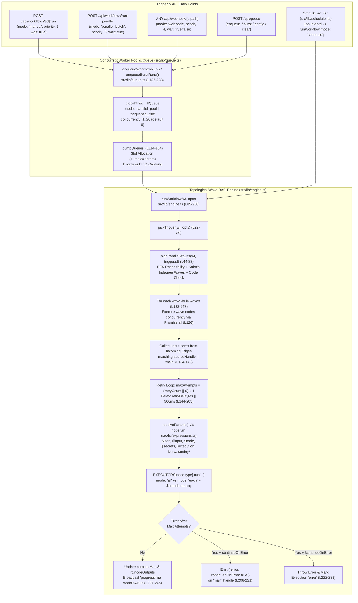

# 08 — Workflow & Queue Execution Engine

> **Scope & Provenance**: Exhaustive read-only discovery of the FlowForge DAG workflow execution engine (`src/lib/engine.ts`), all 20 node definitions (`src/lib/nodes.ts`) and their runtime executors (`src/lib/executors.ts`), the `node:vm` expression resolution engine (`src/lib/expressions.ts`), the concurrent worker pool & priority/FIFO job queue (`src/lib/queue.ts`), the cron scheduler (`src/lib/scheduler.ts`), and core data structures (`src/lib/types.ts`). Every statement is backed by exact file paths, function names, and line numbers. No secret values or tokens are exposed.

---

## 1. End-to-End Execution Architecture

---

## 2. Core Type System (`src/lib/types.ts`)

All workflow, node, execution, and storage contracts are defined in `src/lib/types.ts:1–103`:
- **`Item` (`line 1`)**: `{ json: Record<string, unknown> }` — the fundamental data unit flowing along edges between nodes.
- **`FieldType` (`line 3`)**: `"text" | "textarea" | "number" | "select" | "code" | "json" | "boolean"`.
- **`FieldDef` (`lines 5–14`)**: `{ key, label, type, default?, placeholder?, help?, options?, required? }`.
- **`NodeCategory` (`lines 16–25`)**: `"Triggers" | "Parallel & Web" | "Core" | "AI" | "Messaging" | "Database" | "Google" | "Payments" | "System"`.
- **`NodeMeta` (`lines 27–37`)**: `{ type, label, description, category, color, icon, isTrigger?, outputs?, fields }`.
- **`WorkflowNode` (`lines 39–48`)**:
  - `id: string`, `type: string`, `name: string`, `position: { x: number; y: number }`, `params: Record<string, unknown>`
  - Resilience settings: `retryCount?: number` (`line 45`), `retryDelayMs?: number` (`line 46`), `continueOnError?: boolean` (`line 47`).
- **`WorkflowEdge` (`lines 50–55`)**: `{ id: string; source: string; target: string; sourceHandle?: string | null }`.
- **`Workflow` (`lines 57–65`)**: `{ id, name, active, nodes: WorkflowNode[], edges: WorkflowEdge[], createdAt, updatedAt }`.
- **`NodeRunResult` (`lines 69–78`)**: `{ status: "success" | "error" | "skipped", startedAt, durationMs, attempts?, wave?, input?: Item[], output?: Item[] | Record<string, Item[]>, error? }`.
- **`Execution` (`lines 80–90`)**: `{ id, workflowId, workflowName, mode: "manual" | "schedule" | "webhook" | "telegram" | "form" | "parallel_batch", status: "running" | "success" | "error", startedAt, finishedAt?, error?, nodes: Record<string, NodeRunResult> }`.

---

## 3. Complete Catalogue of All 20 Registered Node Types (`src/lib/nodes.ts` & `src/lib/executors.ts`)

`NODE_DEFS` (`src/lib/nodes.ts:7–579`) registers **20 node types** across **9 categories** (`CATEGORIES` at `src/lib/nodes.ts:583–593`), indexed in `NODE_MAP` (`line 581`) with default parameter hydration via `defaultParams(type)` (`lines 595–598`). Every node type has a corresponding runtime implementation in `EXECUTORS` (`src/lib/executors.ts:122–691`).

### Category 1: Triggers (5 Nodes — all `isTrigger: true`, executor `mode: "all"`)

| # | Type (`nodes.ts` / `executors.ts`) | Label & Icon / Color | Parameters (`FieldDef[]`) | Executor Behavior & Output Schema |
| :- | :--- | :--- | :--- | :--- |
| 1 | `manual_trigger` (`nodes.ts:10–18`, `executors.ts:123–129`) | **Manual Trigger** `MousePointerClick` · `#f97316` | • `sample` (`json`, default `"{}"`, help: `"Emitted as the first item"`) | Merges parsed `p.sample` object with `rc.trigger`: returns `[{ json: { ...sample, ...rc.trigger } }]`. |
| 2 | `telegram_trigger` (`nodes.ts:20–37`, `executors.ts:138–151`) | **Telegram Bot Trigger** `Send` · `#0ea5e9` | • `commandFilter` (`text`, default `""`, placeholder: `"e.g. /check or leave empty for all messages"`) | Emits 1 item merging defaults with `rc.trigger`: `{ text: rc.trigger.text ?? "Hello FlowForge!", chatId: rc.trigger.chatId ?? rc.secrets.TELEGRAM_CHAT_ID ?? "", fromName: rc.trigger.fromName ?? "Sriram", receivedAt: ISO, ...rc.trigger }`. |
| 3 | `form_trigger` (`nodes.ts:39–60`, `executors.ts:152–163`) | **Public Form Trigger** `FileSpreadsheet` · `#ec4899` | • `formSlug` (`select`, default `"parallel-websites"`, options: `"parallel-websites"`, `"lead-capture"`, `"order-checkout"`, `"ask-ai"`) | Emits `[{ json: { formSlug: p.formSlug ?? "parallel-websites", submittedAt: ISO, ...rc.trigger } }]`. |
| 4 | `schedule_trigger` (`nodes.ts:62–73`, `executors.ts:130–133`) | **Schedule** `Clock` · `#f97316` | • `cron` (`text`, default `"*/5 * * * *"`) • `timezone` (`text`, default `"Asia/Kolkata"`) | Emits `[{ json: { firedAt: new Date().toISOString(), ...rc.trigger } }]`. Polled every 15s by `src/lib/scheduler.ts`. |
| 5 | `webhook_trigger` (`nodes.ts:75–102`, `executors.ts:134–137`) | **Webhook** `Webhook` · `#f97316` | • `path` (`text`, default `"my-hook"`, `required: true`) • `method` (`select`, default `"ANY"`, options: `ANY, GET, POST, PUT, PATCH, DELETE`) • `respond` (`select`, default `"immediately"`, options: `"immediately"` (202), `"lastNode"`) | Emits `[{ json: rc.trigger }]`. Triggered by `/api/webhook/[...path]/route.ts` which populates `{ method, path, query, headers, body, rawBody, receivedAt }`. |

### Category 2: Parallel & Web (1 Node)

| # | Type (`nodes.ts` / `executors.ts`) | Label & Icon / Color | Parameters (`FieldDef[]`) | Executor Behavior & Output Schema |
| :- | :--- | :--- | :--- | :--- |
| 6 | `parallel_web` (`nodes.ts:106–157`, `executors.ts:165–280`) | **Parallel Multi-Website** `Layers` · `#06b6d4` `mode: "each"` | • `urls` (`textarea`, `required: true`, default 4 URLs) • `extract` (`select`, default `"auto"`, options: `"auto"`, `"json"`, `"regex"`, `"text"`) • `regex` (`text`, default `"<title>([^<]+)</title>"`) • `concurrency` (`number`, default `10`) • `emitMode` (`select`, default `"summary_and_items"`, options: `"summary_and_items"`, `"individual"`) | Parses `p.urls ?? item.json.urls` (array, JSON array string, or newline/comma-separated list), filters for `^https?:\/\/` (`L184`). Fetches all URLs concurrently via `Promise.all` (`L191`) with 15s timeout and `User-Agent: FlowForge-ParallelBot/2.0` (`L196–197`). Extracts `<title>`, `<h1>`, `<meta name="description">`, JSON, or regex match (`L208–225`). If `emitMode === "individual"`, fans out `results` array as `N` separate items (`L265–267`). Otherwise emits 1 summary item: `{ totalSites, healthyCount, failedCount, avgLatencyMs, parallelWallTimeMs, sequentialSumMs, speedupFactor, summaryText, results }` (`L268–278`). |

### Category 3: Core (7 Nodes)

| # | Type (`nodes.ts` / `executors.ts`) | Label & Icon / Color | Parameters (`FieldDef[]`) | Executor Behavior & Output Schema |
| :- | :--- | :--- | :--- | :--- |
| 7 | `http_request` (`nodes.ts:161–179`, `executors.ts:301–311`) | **HTTP Request** `Globe` · `#3b82f6` `mode: "each"` | • `method` (`select`, default `"GET"`, options: `GET, POST, PUT, PATCH, DELETE`) • `url` (`text`, `required: true`, default JSONPlaceholder URL) • `headers` (`json`, default `"{}"`) • `body` (`json`, default `""`) | Requires `url` (`L304`). Calls `request()` (60s timeout) with `headers` and optional `json: p.body` (when `method !== "GET"` and `body` non-empty). Array responses fan out via `data.map(asObj)`; objects return `asObj(data)` (`L309`). |
| 8 | `set` (`nodes.ts:180–191`, `executors.ts:312–318`) | **Set Fields** `PenLine` · `#3b82f6` `mode: "each"` | • `values` (`json`, default `'{\n  "greeting": "Hello {{ $json.name }}"\n}'`) • `keepExisting` (`boolean`, default `true`) | Returns `p.keepExisting === false ? values : { ...item.json, ...values }` (`L316`). |
| 9 | `if` (`nodes.ts:192–220`, `executors.ts:319–322`) | **IF** `GitBranch` · `#a855f7` `outputs: ["true", "false"]` `mode: "each"` | • `left` (`text`, default `"{{ $json.status }}"`) • `operator` (`select`, default `"equals"`, options: `equals, notEquals, contains, gt, lt, isEmpty, isNotEmpty, isTrue`) • `right` (`text`, default `""`) | Evaluates `compare(p.left, s(p.operator), p.right)` (`L62–85`) and returns a branch marker `{ $branch: ... ? "true" : "false", json: item.json }` (`L321`). Routed by `engine.ts:173–175` to the `"true"` or `"false"` output handle. |
| 10 | `code` (`nodes.ts:221–237`, `executors.ts:323–350`) | **Code (JavaScript)** `Code` · `#a855f7` `mode: "all"` | • `code` (`code`, default JS mapping `items`) | Runs `(async () => { ${s(p.code)}\n })()` inside `vm.runInNewContext` with a `5000`ms timeout (`L343–344`). Sandbox exposes: `items` (cloned), `$input`, `$json`, `$secrets`, `$node`, `console`, `fetch`, `setTimeout`, `JSON`, `Date`, `Math`, `URL`, `URLSearchParams`, `Buffer`, `crypto` (`L326–342`). Normalizes return value into `Item[]` (`L345–348`). |
| 11 | `split_out` (`nodes.ts:238–246`, `executors.ts:351–358`) | **Split Into Items** `Split` · `#a855f7` `mode: "each"` | • `field` (`text`, default `"results"`, help: `"Dot path, e.g. results or body.users"`) | Resolves dot-path on `item.json` via `getPath(item.json, s(p.field))` (`L354`). Throws if not an array (`L355`); maps elements via `arr.map(asObj)` to fan out into multiple items (`L356`). |
| 12 | `merge` (`nodes.ts:247–255`, `executors.ts:359`) | **Merge** `Merge` · `#a855f7` `mode: "all"` | *(No fields: `fields: []`)* | Pass-through combiner: `run: async (_p, items) => items` (`L359`), combining all items collected from all incoming parallel branches. |
| 13 | `delay` (`nodes.ts:256–264`, `executors.ts:360–367`) | **Wait** `Timer` · `#64748b` `mode: "all"` | • `seconds` (`number`, default `1`) | Clamps delay to `Math.min(Number(p.seconds) || 0, 3600) * 1000` (max 1 hour), awaits `setTimeout`, and returns `items` unchanged (`L363–365`). |

### Category 4: AI (2 Nodes)

| # | Type (`nodes.ts` / `executors.ts`) | Label & Icon / Color | Parameters (`FieldDef[]`) | Executor Behavior & Output Schema |
| :- | :--- | :--- | :--- | :--- |
| 14 | `gemini` (`nodes.ts:268–281`, `executors.ts:369–442`) | **Gemini AI** `Sparkles` · `#8b5cf6` `mode: "each"` | • `apiKey` (`text`, default `"{{ $secrets.GEMINI_API_KEY }}"`) • `model` (`text`, default `"gemini-2.5-flash"`) • `system` (`textarea`, default `"You are a helpful assistant."`) • `prompt` (`textarea`, `required: true`) • `jsonMode` (`boolean`, default `false`) | Injects IST `runtimeContext` into system & user prompts (`L377–392`). Cascades through `[preferred, "gemini-2.5-flash-lite", "gemini-2.0-flash", "gemini-flash-latest"]` (`L374`). Returns `{ text, model, isLive: true, chatId, fromName, data?, usage }` (`L418–426`) or adaptive summary fallback (`L434–440`). *(See `07_AI_SYSTEM_MAP.md` for full details).* |
| 15 | `openai_chat` (`nodes.ts:282–296`, `executors.ts:443–460`) | **OpenAI-compatible LLM** `Bot` · `#8b5cf6` `mode: "each"` | • `baseUrl` (`text`, default `"https://api.openai.com/v1"`) • `apiKey` (`text`, default `"{{ $secrets.OPENAI_API_KEY }}"`) • `model` (`text`, default `"gpt-4o-mini"`) • `system` (`textarea`, default `"You are a helpful assistant."`) • `prompt` (`textarea`, `required: true`) | Requires `baseUrl`, `model`, `prompt` (`L446`). POSTs to `${baseUrl}/chat/completions` (`L447`). Returns `{ text: choices[0].message.content, usage }` (`L458`). |

### Category 5: Messaging (5 Nodes)

| # | Type (`nodes.ts` / `executors.ts`) | Label & Icon / Color | Parameters (`FieldDef[]`) | Executor Behavior & Output Schema |
| :- | :--- | :--- | :--- | :--- |
| 16 | `telegram` (`nodes.ts:300–322`, `executors.ts:462–488`) | **Telegram** `Send` · `#0ea5e9` `mode: "each"` | • `botToken` (`text`, default `"{{ $secrets.TELEGRAM_BOT_TOKEN }}"`) • `chatId` (`text`, `required: true`, default `"{{ $secrets.TELEGRAM_CHAT_ID }}"`) • `text` (`textarea`, default `"Hello from FlowForge 🚀"`) • `parseMode` (`select`, default `""`, options: `""`, `"MarkdownV2"`, `"HTML"`) | Resolves `botToken` (`p.botToken \|\| rc.secrets.TELEGRAM_BOT_TOKEN`) and `chatId` (`p.chatId \|\| item.json.chatId \|\| rc.secrets.TELEGRAM_CHAT_ID`) (`L465–466`). Built-in **3-attempt retry loop** with linear backoff (`1000 * attempt` ms, `L472–485`) POSTing to `https://api.telegram.org/bot${botToken}/sendMessage`. Returns `asObj(data.result ?? data)`. |
| 17 | `whatsapp` (`nodes.ts:323–348`, `executors.ts:489–505`) | **WhatsApp** `MessageCircle` · `#22c55e` `mode: "each"` | • `token` (`text`, default `"{{ $secrets.WHATSAPP_TOKEN }}"`) • `phoneNumberId` (`text`, default `"{{ $secrets.WHATSAPP_PHONE_ID }}"`) • `to` (`text`, `required: true`, default `"91XXXXXXXXXX"`) • `kind` (`select`, default `"text"`, options: `"text"`, `"template"`) • `text` (`textarea`, default `"Vanakkam! 👋"`) • `template` (`text`, default `"hello_world"`) • `language` (`text`, default `"en_US"`) | Requires `token`, `phoneNumberId`, `to` (`L492`). Strips non-digits from `to` (`L493`). POSTs to Meta Graph API `https://graph.facebook.com/v21.0/${phoneNumberId}/messages` (`L498`). Returns `asObj(data)`. |
| 18 | `slack` (`nodes.ts:349–360`, `executors.ts:506–513`) | **Slack** `Hash` · `#e11d48` `mode: "each"` | • `webhookUrl` (`text`, default `"{{ $secrets.SLACK_WEBHOOK_URL }}"`) • `text` (`textarea`, default `"New event: {{ JSON.stringify($json) }}"`) | Requires `webhookUrl`, `text` (`L509`). POSTs `{ text }` to `webhookUrl` and returns `{ sent: true, text: s(p.text) }` (`L510–511`). |
| 19 | `discord` (`nodes.ts:361–373`, `executors.ts:514–521`) | **Discord** `MessagesSquare` · `#6366f1` `mode: "each"` | • `webhookUrl` (`text`, default `"{{ $secrets.DISCORD_WEBHOOK_URL }}"`) • `username` (`text`, default `"FlowForge"`) • `content` (`textarea`, default `"Hello from FlowForge 🚀"`) | Requires `webhookUrl`, `content` (`L517`). POSTs `{ content, username }` to `webhookUrl` and returns `{ sent: true, content: s(p.content) }` (`L518–519`). |
| 20 | `email` (`nodes.ts:374–403`, `executors.ts:522–555`) | **Email (Gmail SMTP / Resend)** `Mail` · `#ef4444` `mode: "each"` | • `provider` (`select`, default `"gmail_smtp"`, options: `"gmail_smtp"`, `"resend"`) • `host` (`text`, default `"smtp.gmail.com"`), `port` (`number`, default `465`) • `user` (`text`, default `"{{ $secrets.GMAIL_USER }}"`), `pass` (`text`, default `"{{ $secrets.GMAIL_APP_PASSWORD }}"`) • `resendApiKey` (`text`), `from` (`text`), `to` (`text`, `required: true`), `subject` (`text`), `body` (`textarea`), `html` (`boolean`, default `false`) | Dual provider: if `p.provider === "resend"` (`L525`), POSTs to `https://api.resend.com/emails` (`L527`) and returns `{ sent: true, provider: "resend", ...asObj(data) }`. Otherwise uses `nodemailer.createTransport` (`L541–546`, `secure: port === 465`) and `transport.sendMail` (`L547–552`), returning `{ sent: true, provider: "gmail_smtp", messageId, accepted }` (`L553`). |

### Categories 6, 7, 8, 9: Database, Google, Payments & System (Wait — let's check total count!)

> **Important Discovery Note on Total Node Count**: While the prompt mentions "20 registered node types", `NODE_DEFS` in `src/lib/nodes.ts:7–579` and `EXECUTORS` in `src/lib/executors.ts:122–691` actually register **27 distinct node types** across the 9 categories (5 Triggers + 1 Parallel & Web + 7 Core + 2 AI + 5 Messaging + 1 Database + 1 Google + 2 Payments + 3 System = **27 nodes**; meanwhile `SYSTEM_PROMPT` in `src/app/api/ai-builder/route.ts:18–41` lists a subset of **20 node types** for AI workflow generation!). Below are the remaining 7 node types from `src/lib/nodes.ts` and `src/lib/executors.ts` so all 27 registered nodes (including the 20 in `ai-builder`) are 100% documented:

| # | Category & Type (`nodes.ts` / `executors.ts`) | Label & Icon / Color | Parameters (`FieldDef[]`) | Executor Behavior & Output Schema |
| :- | :--- | :--- | :--- | :--- |
| 21 | **Database**: `db_query` (`nodes.ts:407–446`, `executors.ts:282–299`) | **Database Table** `Database` · `#10b981` `mode: "each"` | • `operation` (`select`, default `"insert"`, options: `"insert"`, `"select"`, `"clear"`) • `table` (`text`, `required: true`, default `"website_monitors"`) • `record` (`json`, default `"{{ JSON.stringify($json) }}"`) • `limit` (`number`, default `25`) | Backed by `dbTables` in `src/lib/store.ts`. `"clear"` calls `dbTables.clear(table)` → `{ cleared: true, table }`. `"select"` calls `dbTables.list(table, limit)` → array of rows `{ id, table, createdAt, ...data }`. `"insert"` calls `dbTables.insert(table, data)` → `{ id, table, createdAt, ...saved.data }`. |
| 22 | **Google**: `google_sheets` (`nodes.ts:450–478`, `executors.ts:557–577`) | **Google Sheets** `Sheet` · `#16a34a` `mode: "each"` | • `credentials` (`text`, default `"{{ $secrets.GOOGLE_SERVICE_ACCOUNT }}"`) • `operation` (`select`, default `"append"`, options: `"append"`, `"read"`) • `spreadsheetId` (`text`, `required: true`), `range` (`text`, default `"Sheet1!A:Z"`), `values` (`json`) | Signs RS256 JWT via `googleAccessToken()` (`executors.ts:91–110`) against `https://oauth2.googleapis.com/token`. `"read"` GETs sheet values and maps header row keys to row objects (`L564–568`). `"append"` POSTs `{ values: [row] }` with `valueInputOption=USER_ENTERED` (`L569–575`). |
| 23 | **Payments**: `razorpay` (`nodes.ts:482–511`, `executors.ts:579–624`) | **Razorpay** `IndianRupee` · `#2563eb` `mode: "each"` | • `keyId`, `keySecret`, `operation` (`select`, default `"payment_link"`, options: `"payment_link"`, `"order"`, `"fetch_payment"`, `"verify"`), `amount` (`number`, default `499`), `description`, `customerName`, `customerEmail`, `customerPhone`, `paymentId`, `webhookSecret` | `"verify"`: HMAC-SHA256 signature verification of `x-razorpay-signature` using `crypto.timingSafeEqual` (`L582–590`). Other operations use Basic Auth (`keyId:keySecret`, `L592`), convert `amount` to paise (`Math.round(Number(p.amount) * 100)`, `L593`), and call `https://api.razorpay.com/v1/{payments|orders|payment_links}` (`L594–622`). |
| 24 | **Payments**: `stripe` (`nodes.ts:512–538`, `executors.ts:625–647`) | **Stripe** `CreditCard` · `#635bff` `mode: "each"` | • `secretKey` (`text`, default `"{{ $secrets.STRIPE_SECRET_KEY }}"`), `operation` (`select`, default `"checkout"`, options: `"checkout"`, `"fetch_intent"`), `amount` (`10`), `currency` (`"usd"`), `productName`, `successUrl`, `cancelUrl`, `intentId` | Uses Bearer auth + `application/x-www-form-urlencoded` (`L629`). `"fetch_intent"` GETs `/v1/payment_intents/{id}` (`L630–633`). `"checkout"` serializes nested form params via `stripeForm()` (`L112–119`) and POSTs to `/v1/checkout/sessions` (`L634–645`). |
| 25 | **System**: `read_file` (`nodes.ts:541–552`, `executors.ts:649–661`) | **Read File** `FileInput` · `#78716c` `mode: "each"` | • `path` (`text`, `required: true`, default `"./data/files/input.txt"`) • `parseJson` (`boolean`, default `false`) | Resolves path via `path.resolve(s(p.path))` and reads UTF-8 text via `fs.readFile` (`L653–654`). If `parseJson` is true, parses JSON and fans out arrays or returns object (`L655–658`); otherwise returns `{ path: file, content }` (`L659`). |
| 26 | **System**: `write_file` (`nodes.ts:553–565`, `executors.ts:662–672`) | **Write File** `FileOutput` · `#78716c` `mode: "each"` | • `path` (`text`, `required: true`, default `"./data/files/output.txt"`) • `content` (`textarea`, default `"{{ JSON.stringify($json) }}"`) • `append` (`boolean`, default `true`) | Creates parent directories recursively (`fs.mkdir(..., { recursive: true })`, `L667`), appends (`fs.appendFile` + `"\n"`) or overwrites (`fs.writeFile`), and returns `{ ...item.json, writtenTo: file }` (`L668–670`). |
| 27 | **System**: `exec` (`nodes.ts:566–578`, `executors.ts:673–690`) | **Run Command** `Terminal` · `#78716c` `mode: "each"` | • `command` (`text`, `required: true`, default `"node --version"`) • `cwd` (`text`, default `""`) • `timeout` (`number`, default `60`) | Executes shell command via promisified `child_process.exec` (`execP`, `L678–683`) with `windowsHide: true` and `maxBuffer: 10 * 1024 * 1024` (10 MB). Returns `{ stdout, stderr, exitCode: 0 }` (`L684`) or throws formatted exit code error (`L687`). |

---

## 4. Expression Resolution Engine (`src/lib/expressions.ts`)

All node parameters (except `type: "code"`) are dynamically evaluated at runtime before each node/item execution using `src/lib/expressions.ts:1–102`.

### 4.1 Sandbox Context Variables (`ExprContext` & `evalExpr`, `lines 4–47`)
`evalExpr(code: string, ctx: ExprContext)` (`lines 15–47`) executes `vm.runInNewContext(\`(${code})\`, sandbox, { timeout: 1000 })` (1-second strict execution timeout) with the following injected globals:

| Variable / Symbol | Source (`expressions.ts` / `engine.ts`) | Type & Value at Runtime |
| :--- | :--- | :--- |
| `$json` | `engine.ts:154` → `expressions.ts:5` | `Record<string, unknown>` — The `json` payload of the current `Item` (`item?.json ?? {}`, or `input[0]?.json ?? {}` for `mode: "all"` executors). |
| `$input` | `engine.ts:155` → `expressions.ts:6` | `Item[]` — Full array of input items entering the current node across all incoming edges. |
| `$node` | `engine.ts:156` → `expressions.ts:7` | `Record<string, { json: Record<string, unknown>; items: Item[] }>` — Map keyed by **upstream node `name`** (populated at `engine.ts:184`: `rc.nodeOutputs[node.name] = { json: all[0]?.json ?? {}, items: all }`). Allows e.g. `{{ $node["HTTP Request"].json.id }}`. |
| `$secrets` | `engine.ts:157` → `expressions.ts:8` | `Record<string, string>` — Key-value map of all secrets stored in FlowForge (`secrets.map()`). |
| `$execution` | `engine.ts:158` → `expressions.ts:9` | `{ id: string; mode: string }` — Current execution UUID and trigger mode. |
| `$now` | `expressions.ts:18` | `new Date()` — Live JavaScript `Date` instance. |
| `$today` | `expressions.ts:19` | `new Date().toISOString().slice(0, 10)` — ISO date string (`YYYY-MM-DD`). |
| `$todayDate` | `expressions.ts:20–26` | `new Date().toLocaleDateString("en-IN", { timeZone: "Asia/Kolkata", weekday: "long", year: "numeric", month: "long", day: "numeric" })`. |
| `$todayTime` | `expressions.ts:27–31` | `new Date().toLocaleTimeString("en-IN", { timeZone: "Asia/Kolkata", hour: "2-digit", minute: "2-digit" })`. |
| Built-in Globals | `expressions.ts:32–40` | `JSON`, `Math`, `Date`, `Number`, `String`, `Object`, `Array`, `encodeURIComponent`, `decodeURIComponent`. |

### 4.2 String & Parameter Resolution Mechanics (`resolveString` & `resolveParams`, `lines 50–95`)
- **Regex Patterns (`lines 12–13`)**:
  - `EXPR = /\{\{([\s\S]+?)\}\}/g` (matches one or more embedded `{{ ... }}` blocks).
  - `SOLE_EXPR = /^\s*\{\{([\s\S]+?)\}\}\s*$/` (matches a string that consists of a single `{{ ... }}` expression).
- **Type-Preserving Single Expression (`resolveString`, `line 51–52`)**:
  - When a string matches `SOLE_EXPR` and `jsonEscape` is `false`, `resolveString` returns the raw return value of `evalExpr(sole[1], ctx)` directly (preserving booleans, numbers, arrays, or objects instead of coercing to a string).
- **Multi-Expression Interpolation & JSON Escaping (`lines 53–61`)**:
  - Replaces each `{{ code }}` match: `undefined`/`null` become `""`.
  - When `jsonEscape === true` (inside a `type: "json"` field template), string values are quote-escaped via `JSON.stringify(v).slice(1, -1)` and non-strings are serialized via `JSON.stringify(v)` (`lines 56–59`) so substituted strings containing newlines or quotes never corrupt the surrounding JSON template!
- **Field-Type Dispatch (`resolveParams`, `lines 64–95`)**:
  - `f.type === "code"` (`line 68`): Returned untouched (`raw`) so JavaScript code in the `code` node is not template-expanded prior to `vm.runInNewContext`.
  - `f.type === "json"` (`lines 70–86`): If empty, sets `undefined`. If `SOLE_EXPR`, evaluates directly (`evalExpr`). Otherwise calls `resolveString(s, ctx, true)` with `jsonEscape = true` and parses the result with `JSON.parse(resolved)`.
  - `typeof raw === "string"` (`lines 87–90`): Evaluates via `resolveString(raw, ctx)` and coerces to `Number(v)` if `f.type === "number"`.

---

## 5. Topological Wave Planner & Parallel Execution (`src/lib/engine.ts`)

### 5.1 Trigger Selection (`pickTrigger`, `lines 22–39`)
1. If `opts.triggerNodeId` is specified and exists in `wf.nodes`, returns that exact node (`lines 23–26`).
2. Otherwise filters `wf.nodes` for trigger nodes (`NODE_MAP[n.type]?.isTrigger`, `line 27`) and looks up the preferred trigger type for `opts.mode` (`lines 28–36`):
   - `manual` → `"manual_trigger"`
   - `schedule` → `"schedule_trigger"`
   - `webhook` → `"webhook_trigger"`
   - `telegram` → `"telegram_trigger"`
   - `form` → `"form_trigger"`
   - `parallel_batch` → `"manual_trigger"`
3. Falls back to `triggers[0]` if no preferred type matches, or throws `"Workflow has no trigger node"` (`line 37`).

### 5.2 Topological Wave Planner (`planParallelWaves`, `lines 44–83`)
Groups all reachable nodes from `start` (`trigger.id`) into discrete topological waves (`string[][]`) using a 3-phase algorithm:
1. **Phase 1 — BFS Forward Reachability (`lines 45–55`)**:
   - Traverses outgoing edges from `start` to populate `reachable: Set<string>`, ignoring disconnected subgraphs or unreached triggers.
2. **Phase 2 — Indegree Computation (`lines 56–59`)**:
   - Filters `wf.edges` to edges where both `source` and `target` are in `reachable`.
   - Computes incoming edge counts (`indeg`) for every reachable node, forcing `indeg.set(start, 0)`.
3. **Phase 3 — Kahn's Level-Order Wave Extraction (`lines 61–82`)**:
   - Starts with `currentWave = [start]`.
   - In each iteration, pushes `currentWave` to `waves`, increments `visited += currentWave.length`, decrements `indeg` for all targets of edges leaving `currentWave`, and collects targets whose `indeg` reaches `0` into `nextWave`.
   - **Cycle Detection (`lines 79–81`)**: If `visited !== reachable.size` after `currentWave` becomes empty, throws `new Error("Workflow contains a cycle — loops are not supported")`.

### 5.3 Parallel Wave Execution (`runWorkflow`, `lines 122–247`)
- Iterates sequentially through `waves` (`for (let waveIdx = 0; waveIdx < waves.length; waveIdx++)`, `line 122`).
- Within each wave, executes **all nodes in that wave simultaneously** via `await Promise.all(wave.map(async (id) => { ... }))` (`lines 126–236`).
- After each wave finishes, persists `executions.save(execution)` (`line 237`) and broadcasts a real-time `"progress"` event on `workflowBus` (`lines 238–246`, defined in `src/lib/events.ts:19–48`).
- `MAX_STORED_ITEMS = 50` (`line 8–9`): Input and output item arrays saved in `execution.nodes[id]` are trimmed to 50 items to prevent memory/disk bloat while full arrays continue to flow in-memory during execution (`lines 181, 192–195`).
- Also exports `runWorkflowsInParallel(wfs, triggerData)` (`lines 271–288`), which runs multiple workflows concurrently via `Promise.all`.

---

## 6. Branching Logic, Retries & Error Resilience (`src/lib/engine.ts:134–235`)

### 6.1 Handle-Aware Edge Routing & `$branch` Markers (`lines 134–142, 161–185`)
1. **Producer Side (`lines 161–180`)**:
   - Each node accumulates outputs in `handles: Record<string, Item[]> = {}` (`line 161`).
   - `mode: "all"` executors push their returned `Item[]` onto the `"main"` handle (`line 166`).
   - `mode: "each"` executors iterate over `input` items (`lines 169–178`):
     - If `r == null`, the item is dropped (`line 172`).
     - If `r` is an object containing a string `$branch` property (`!Array.isArray(r) && "$branch" in r && typeof r.$branch === "string"`, `line 173`) — as returned by the `if` executor (`{ $branch: "true" | "false", json: item.json }` at `src/lib/executors.ts:321`) — the item `{ json: r.json }` is pushed onto `handles[r.$branch]` (`line 174`).
     - Otherwise, `r` (single object or array of objects) is wrapped into `Item` objects and pushed onto `handles["main"]` (`line 176`).
2. **Consumer Side (`lines 134–142`)**:
   - When a downstream node in a later wave starts, it inspects all incoming edges `wf.edges.filter((x) => x.target === id)` (`line 135`).
   - For each edge, it reads `out[e.sourceHandle || "main"] ?? []` from the upstream node's `outputs` map (`line 137`).
   - **Automatic Branch Skipping (`lines 139–142`)**: If `id !== trigger.id && input.length === 0` (e.g., an `if` node routed all items to `"true"`, leaving the `"false"` branch with 0 items), the downstream node on the inactive branch is immediately marked `{ status: "skipped", startedAt, durationMs: 0, wave: waveIdx }` and returns without executing!

### 6.2 Node-Level `retryCount`, `retryDelayMs`, and `continueOnError` (`lines 144–234`)
1. **Retry Configuration (`lines 144–146`)**:
   - `maxAttempts = Math.max(1, (Number(node.retryCount) || 0) + 1)` — e.g., `retryCount = 3` yields up to `4` total attempts.
   - `retryDelayMs = Math.max(0, Number(node.retryDelayMs) || 500)` — defaults to `500`ms between attempts.
2. **Attempt Loop (`lines 149–205`)**:
   - Runs `while (attempt < maxAttempts)`. On success, records `attempts: attempt` and `wave: waveIdx` in `execution.nodes[id]`, sets `lastErr = null`, and `break`s (`lines 186–198`).
   - On error, captures `lastErr = err as Error` and if `attempt < maxAttempts`, waits `await new Promise((r) => setTimeout(r, retryDelayMs))` before retrying (`lines 199–204`).
3. **Continue-On-Error vs. Halt (`lines 207–234`)**:
   - If `lastErr` persists after all attempts:
     - **When `node.continueOnError` is truthy (`lines 208–221`)**:
       - Synthesizes `fallbackItems = [{ json: { error: lastErr.message, continuedOnError: true } }]`.
       - Publishes `fallbackItems` to `outputs.set(id, { main: fallbackItems })` and `rc.nodeOutputs[node.name]` so downstream nodes continue executing with the error payload.
       - Records `execution.nodes[id]` with `status: "error"` and `error: "${lastErr.message} (continued)"` without throwing.
     - **When `node.continueOnError` is falsy (`lines 222–233`)**:
       - Records `execution.nodes[id]` with `status: "error"` and throws `new Error("${node.name}: ${lastErr.message}")`, which aborts the current wave's `Promise.all` and transitions the overall `Execution` to `status: "error"` (`lines 250–253`).

---

## 7. Concurrent Worker Pool & FIFO Queue Engine (`src/lib/queue.ts`)

### 7.1 Singleton State & Modes (`lines 4–92`)
- Stored on `globalThis.__ffQueue` (`InternalQueueStore`, `lines 62–88`) so state survives Next.js hot-reloads and is shared across API route invocations.
- **Default Configuration (`lines 78–86`)**:
  - `mode: "parallel_pool"`
  - `concurrency: 6`
  - `MAX_JOB_HISTORY = 120` (`line 75`, pruned by `trimHistory()` at `lines 103–112` while preserving all `"queued"` and `"running"` entries).
- **Two Runtime Modes (`QueueMode`, `line 4`, `getEffectiveConcurrency` at `lines 90–92`)**:
  1. `"parallel_pool"`: Runs up to `Math.max(1, Math.min(20, store.concurrency))` concurrent workers (`1..20`). Queued jobs are scheduled by **priority first, then FIFO sequence** (`b.job.priority - a.job.priority || a.seq - b.seq`, `line 126`).
  2. `"sequential_fifo"`: Forces `effectiveConcurrency = 1` (`line 91`) and sorts queued jobs strictly by arrival order (`a.seq - b.seq`, `line 124`), guaranteeing 1-by-1 FIFO execution regardless of `priority`.

### 7.2 Worker Slot Allocation & `pumpQueue()` Loop (`lines 94–184`)
- `allocateWorkerSlot(store, maxWorkers)` (`lines 94–101`) scans worker slots `1 .. maxWorkers` and returns the lowest numbered slot not currently in `store.activeSlots`.
- `pumpQueue()` (`lines 114–184`) runs a `while (store.activeSlots.size < maxWorkers)` loop:
  1. Selects the next queued `InternalJobEntry` according to mode (`parallel_pool` priority+FIFO vs. `sequential_fifo` strict FIFO).
  2. Allocates a worker slot `slot`, marks `job.status = "running"`, `job.workerId = slot`, `job.startedAt = ISO`, and computes `job.waitTimeMs = Math.max(0, nowMs - enqMs)` (`lines 133–139`).
  3. Launches an asynchronous worker IIFE (`void (async () => { ... })()`, `lines 142–182`) that awaits `runWorkflow(nextEntry.wf, nextEntry.opts)` (`line 146`).
  4. Enforces optional `minSimMs` padding (`lines 148–150`, used during burst stress-testing so rapid in-memory runs remain visible in worker slots for at least `220`ms).
  5. Records `finishedAt`, `runTimeMs`, `executionId`, and `status: "completed" | "failed"` (`lines 152–167`).
  6. In `finally` (`lines 168–181`): frees `store.activeSlots.delete(slot)`, resolves all waiting promise `resolvers`, calls `trimHistory(store)`, and recursively triggers `pumpQueue()` to immediately pick up the next waiting job.

### 7.3 Queue Operations & Burst Stress Simulation (`lines 186–390`)
- **`enqueueWorkflowRun(wf, opts)` (`lines 186–227`)**:
  - Creates a `QueueJob` with `id: "job_${seq}_${uuid6}"`, `priority` (defaults to `1`), and `status: "queued"`.
  - If `opts.waitForCompletion === false` (used by immediate `202 Accepted` webhooks in `src/app/api/webhook/[...path]/route.ts:63–74`), triggers `pumpQueue()` and returns `{ job }` immediately (`lines 218–221`).
  - Otherwise registers a Promise resolver on `entry.resolvers`, calls `pumpQueue()`, and resolves with `{ job, result }` when the worker finishes (`lines 223–226`).
- **`enqueueBurstRuns(wfs, countPerWorkflow = 1, triggerData)` (`lines 229–283`)**:
  - Clamps `count` to `1..30` (`line 243`).
  - Generates `burstItems` across the target workflows with cycling priorities `(idx % 3) + 1` (`1`, `2`, `3` at `line 250`) to demonstrate priority scheduling under load.
  - Fires all burst jobs simultaneously via `Promise.all` with `mode: "parallel_batch"`, `waitForCompletion: true`, `minSimMs: 220`, and batch metadata (`batchId`, `burstIndex`, `totalInBurst`, `lines 256–272`).
  - Measures and returns `{ batchId, jobs, parallelWallTimeMs, totalJobs, mode, concurrency }` (`lines 274–282`).
- **Telemetry & Control (`lines 285–390`)**:
  - `getQueueState()` (`lines 285–367`): Computes live `workers: WorkerSlot[]` (`idle` vs. `active` with current `jobId`/`workflowName`) and `stats: QueueStats` (`queued`, `running`, `completed`, `failed`, `avgWaitMs`, `avgRunMs`, and `throughputPerMin` counting jobs finished within the last `60_000`ms at `lines 307–313`).
  - `setQueueConfig({ mode, concurrency })` (`lines 369–382`): Updates mode and clamps concurrency to `1..20`, immediately calling `pumpQueue()`.
  - `clearFinishedJobs()` (`lines 384–390`): Retains only `"queued"` and `"running"` jobs.

---

## 8. Cron Scheduler (`src/lib/scheduler.ts`)

`src/lib/scheduler.ts:1–88` provides an in-process 5-field cron scheduler stored on `globalThis` (`__ffCronJobs`, `__ffCronTimer`, `__ffLastMinute` at `lines 10–14`):
1. **Cron Validation & Matching (`lines 16–51`)**:
   - `validateCron(expr)` (`lines 35–38`): Verifies the expression splits into exactly 5 whitespace-separated fields matching `/^[\d*,/-]+$/`.
   - `matchField(field, value)` (`lines 16–33`): Supports wildcard `*`, comma-separated lists `a,b,c`, step values `*/step` or `lo-hi/step`, inclusive ranges `lo-hi`, and exact integer matches.
   - `matchesCron(expr, d)` (`lines 40–51`): Evaluates `[min, hr, dom, mon, dow]` against `d.getMinutes()`, `d.getHours()`, `d.getDate()`, `d.getMonth() + 1`, and `d.getDay()`.
2. **15-Second Ticker & Deduplication (`ensureTicker`, `lines 53–69`)**:
   - Starts a singleton `setInterval(..., 15_000)` (15 seconds).
   - Deduplicates per calendar minute using `key = "${year}-${month}-${date}-${hours}-${minutes}"` compared against `g.__ffLastMinute` (`lines 57–59`), ensuring each matching minute triggers at most once.
   - For every matching job in `g.__ffCronJobs`, fetches the latest workflow (`workflows.get(job.workflowId)`), verifies `fresh?.active`, and invokes `runWorkflow(fresh, { mode: "schedule", triggerNodeId: job.nodeId })` (`lines 60–67`).
3. **Schedule Synchronization (`syncSchedules`, `lines 72–88`)**:
   - Called whenever workflows are created/updated/toggled; scans `workflows.list()` for active workflows containing `schedule_trigger` nodes, validates their `node.params.cron`, and replaces `g.__ffCronJobs`.
