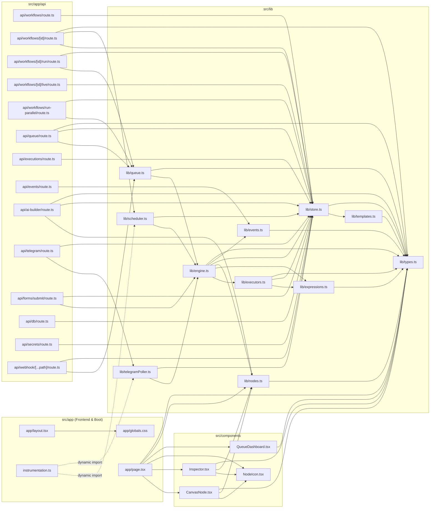

# 09 — Dependency Map

> **Inspection Status:** `CONFIRMED`  
> **Scope:** Complete analysis of `package.json` runtime & development dependencies, Node.js built-in modules (`node:*`), internal TypeScript module import graph across `src/`, and external network API endpoints contacted at runtime.

---

## 1. NPM Package Dependencies (`package.json`) (`CONFIRMED`)

### 1.1 Production Dependencies (`package.json:11-19`)

| Package | Version Spec | Imported In | Exact Role in FlowForge |
| :--- | :---: | :--- | :--- |
| `next` | `16.4.6` | `next.config.ts:1`, `src/app/layout.tsx:1-2`, `src/app/api/**/route.ts` (`next/server`) | Core full-stack React framework, App Router page routing, `NextResponse` REST/SSE API Route Handlers, Google font loader (`next/font/google`), and `src/instrumentation.ts` server boot hook. |
| `react` | `19.3.0` | `src/app/page.tsx:3`, `src/components/CanvasNode.tsx:3`, `src/components/Inspector.tsx:3`, `src/components/QueueDashboard.tsx:3` | Core UI component library and hooks (`useState`, `useEffect`, `useCallback`, `useMemo`, `useRef`, `memo`). |
| `react-dom` | `19.3.0` | Implicitly used by Next.js client/server rendering | DOM rendering engine for React 19. |
| `@xyflow/react` | `^12.12.1` | `src/app/page.tsx:4-16`, `src/components/CanvasNode.tsx:4` | Interactive node-based DAG canvas (`ReactFlow`, `Background`, `Controls`, `MiniMap`, `Handle`, `Position`, `MarkerType`, `useNodesState`, `useEdgesState`, and `@xyflow/react/dist/style.css`). |
| `lucide-react` | `^1.71.0` | `src/app/page.tsx:17-51`, `src/components/CanvasNode.tsx:5-12`, `src/components/Inspector.tsx:4-18`, `src/components/NodeIcon.tsx:1-30`, `src/components/QueueDashboard.tsx:4-21` | Vector iconography across the studio header, node cards, inspector tabs, and telemetry dock. |
| `nodemailer` | `^10.3.1` | `src/lib/executors.ts:7, 541-553` | SMTP email transport (`nodemailer.createTransport` & `transport.sendMail`) used by the `email` node executor when `provider === "gmail_smtp"`. |
| `@types/nodemailer` | `^8.0.2` | TypeScript compiler (`src/lib/executors.ts:7`) | TypeScript type definitions for `nodemailer` (listed under `dependencies` in `package.json:12`). |

### 1.2 Development Dependencies (`package.json:20-29`)

| Package | Version Spec | Configured / Used In | Purpose |
| :--- | :---: | :--- | :--- |
| `tailwindcss` | `4.3.3` | `src/app/globals.css:1` (`@import "tailwindcss";`) | Utility-first CSS framework (v4 with `@theme inline` and `@apply`). |
| `@tailwindcss/turbopack` | `4.3.3` | `next.config.ts:10` | Turbopack CSS loader for Tailwind CSS v4 (`rules["*.css"].loaders`). |
| `typescript` | `^5` | `tsconfig.json:1-34` | TypeScript compiler (`strict: true`, `target: "ES2017"`, `moduleResolution: "bundler"`). |
| `@types/node` | `^20` | Global Node.js types (`fs`, `path`, `crypto`, `vm`, `child_process`, `process`) | TypeScript definitions for Node.js runtime APIs. |
| `@types/react` | `^19` | Global React types | TypeScript definitions for React 19. |
| `@types/react-dom` | `^19` | Global React DOM types | TypeScript definitions for React DOM 19. |
| `eslint` | `^9` | `eslint.config.mjs:1` (`eslint/config`) | JavaScript/TypeScript linter. |
| `eslint-config-next` | `16.4.6` | `eslint.config.mjs:2-3` | Next.js core-web-vitals and TypeScript ESLint rulesets. |

---

## 2. Node.js Built-In Modules Used (`CONFIRMED`)

| Node.js Module | Imported In (File & Line) | Functions / APIs Invoked | Purpose & Security / Runtime Characteristics |
| :--- | :--- | :--- | :--- |
| `node:fs` (Synchronous FS) | `src/lib/store.ts:1` | `fs.existsSync`, `fs.readFileSync`, `fs.mkdirSync`, `fs.writeFileSync` (`store.ts:25, 28, 72, 83, 108, 109`) | Synchronous JSON database persistence (`data/db.json`) and `.env` file parsing (`D:\My n8n\.env`, `.env.local`). |
| `node:fs/promises` (Async FS) | `src/lib/executors.ts:2` | `fs.readFile`, `fs.mkdir`, `fs.appendFile`, `fs.writeFile` (`executors.ts:654, 667, 668, 669`) | Asynchronous file reading and writing for the `read_file` and `write_file` workflow nodes. |
| `node:path` | `src/lib/store.ts:2`, `src/lib/executors.ts:3` | `path.join` (`store.ts:6-12`), `path.resolve`, `path.dirname` (`executors.ts:653, 666, 667`) | Resolves `data/db.json`, `.env` paths, and user-specified paths in `read_file`/`write_file` nodes relative to `process.cwd()`. |
| `node:crypto` | `src/lib/executors.ts:1` (plus global `crypto.randomUUID()` in `engine.ts`, `queue.ts`, `store.ts`, `telegramPoller.ts`, `page.tsx`) | `crypto.createSign("RSA-SHA256")`, `crypto.createHmac("sha256")`, `crypto.timingSafeEqual`, `crypto.randomUUID()` | RS256 JWT signing for Google Sheets OAuth2 (`executors.ts:102`), HMAC-SHA256 webhook signature verification for Razorpay (`executors.ts:587-588`), exposed inside `code` node sandbox (`executors.ts:341`), and UUID generation across the app. |
| `node:vm` | `src/lib/expressions.ts:1`, `src/lib/executors.ts:6` | `vm.runInNewContext(code, sandbox, { timeout })` | Sandboxed JavaScript evaluation: 1,000ms timeout for `{{ expr }}` templates (`expressions.ts:43`) and 5,000ms timeout for async IIFE in the `code` node (`executors.ts:344`). |
| `node:child_process` | `src/lib/executors.ts:4` | `exec` (promisified as `execP` at `executors.ts:12, 678`) | Executes shell commands for the `exec` ("Run Command") node with configurable `cwd`, `timeout` (default 60s), `windowsHide: true`, and `maxBuffer: 10MB`. |
| `node:util` | `src/lib/executors.ts:5` | `promisify` (`executors.ts:12`) | Wraps `child_process.exec` into a Promise-returning function (`execP`). |

---

## 3. Internal Module Import Graph (`CONFIRMED`)

### 3.1 Mermaid Dependency Graph Across `src/`

---

### 3.2 Exhaustive File-by-File Import & Export Matrix (`CONFIRMED`)

| Source File | Internal Imports (`@/...` or `./...`) | External Package / Built-in Imports | Exported Symbols | Imported By (Dependents) |
| :--- | :--- | :--- | :--- | :--- |
| `src/lib/types.ts` | *None (leaf module)* | *None* | `Item`, `FieldType`, `FieldDef`, `NodeCategory`, `NodeMeta`, `WorkflowNode`, `WorkflowEdge`, `Workflow`, `RunStatus`, `NodeRunResult`, `Execution`, `Secret`, `DbRecord` | `nodes.ts`, `templates.ts`, `events.ts`, `expressions.ts`, `store.ts`, `executors.ts`, `engine.ts`, `queue.ts`, `CanvasNode.tsx`, `Inspector.tsx`, `QueueDashboard.tsx`, `page.tsx`, `ai-builder/route.ts`, `queue/route.ts`, `workflows/[id]/route.ts` |
| `src/lib/nodes.ts` | `./types` | *None* | `NODE_DEFS`, `NODE_MAP`, `CATEGORIES`, `defaultParams` | `engine.ts`, `CanvasNode.tsx`, `Inspector.tsx`, `page.tsx`, `ai-builder/route.ts` |
| `src/lib/templates.ts` | `./types` | *None* | `STARTER_WORKFLOWS` | `store.ts` |
| `src/lib/events.ts` | `./types` | *None* | `WorkflowEventType`, `WorkflowEvent`, `workflowBus` | `engine.ts`, `api/events/route.ts` |
| `src/lib/expressions.ts` | `./types` | `node:vm` | `ExprContext`, `resolveString`, `resolveParams`, `getPath` | `engine.ts`, `executors.ts` |
| `src/lib/store.ts` | `./templates`, `./types` | `node:fs`, `node:path` | `workflows`, `executions`, `secrets`, `dbTables` | `engine.ts`, `executors.ts`, `scheduler.ts`, `telegramPoller.ts`, and 12 API routes (`ai-builder`, `db`, `executions`, `forms/submit`, `queue`, `secrets`, `telegram`, `webhook/[...path]`, `workflows`, `workflows/run-parallel`, `workflows/[id]`, `workflows/[id]/live`, `workflows/[id]/run`) |
| `src/lib/executors.ts` | `./expressions`, `./store`, `./types` | `node:crypto`, `node:fs/promises`, `node:path`, `node:child_process`, `node:util`, `node:vm`, `nodemailer` | `RunCtx`, `EachResult`, `Executor`, `EXECUTORS` | `engine.ts` |
| `src/lib/engine.ts` | `./executors`, `./expressions`, `./nodes`, `./store`, `./events`, `./types` | *None* | `RunOptions`, `RunResult`, `runWorkflow`, `runWorkflowsInParallel` | `queue.ts`, `scheduler.ts`, `telegramPoller.ts`, `api/forms/submit/route.ts` |
| `src/lib/queue.ts` | `./engine`, `./types` | *None* | `QueueMode`, `QueueJob`, `WorkerSlot`, `QueueStats`, `QueueState`, `enqueueWorkflowRun`, `enqueueBurstRuns`, `getQueueState`, `setQueueConfig`, `clearFinishedJobs` | `api/queue/route.ts`, `api/workflows/[id]/run/route.ts`, `api/workflows/run-parallel/route.ts`, `api/webhook/[...path]/route.ts` |
| `src/lib/scheduler.ts` | `./engine`, `./store` | *None* | `validateCron`, `syncSchedules` | `instrumentation.ts`, `api/workflows/[id]/route.ts` |
| `src/lib/telegramPoller.ts` | `./engine`, `./store` | *None* | `TelegramLogEntry`, `getTelegramStatus`, `triggerTelegramWorkflows`, `startTelegramListener`, `stopTelegramListener` | `instrumentation.ts`, `api/telegram/route.ts` |
| `src/instrumentation.ts` | `./lib/scheduler` (dynamic), `./lib/telegramPoller` (dynamic) | *None* | `register` | Next.js Node.js server bootstrap |
| `src/components/NodeIcon.tsx` | *None* | `lucide-react` | `NodeIcon` | `CanvasNode.tsx`, `Inspector.tsx`, `page.tsx` |
| `src/components/CanvasNode.tsx` | `@/lib/nodes`, `@/lib/types`, `./NodeIcon` | `react`, `@xyflow/react`, `lucide-react` | `CanvasNodeData`, `CanvasNode` | `page.tsx` |
| `src/components/Inspector.tsx` | `@/lib/nodes`, `@/lib/types`, `./NodeIcon` | `react`, `lucide-react` | `Inspector` | `page.tsx` |
| `src/components/QueueDashboard.tsx` | `@/lib/types` | `react`, `lucide-react` | `QueueJobView`, `QueueStateView`, `QueueDashboardProps`, `QueueDashboard` | `page.tsx` |
| `src/app/layout.tsx` | `./globals.css` | `next`, `next/font/google` | `metadata`, `RootLayout` (default) | Next.js App Router root |
| `src/app/page.tsx` | `@/lib/nodes`, `@/lib/types`, `@/components/CanvasNode`, `@/components/Inspector`, `@/components/NodeIcon`, `@/components/QueueDashboard` | `react`, `@xyflow/react`, `@xyflow/react/dist/style.css`, `lucide-react` | `FlowForgeStudio` (default) | Next.js App Router `/` page |

> **Unused Export Note (`CONFIRMED`):** `runWorkflowsInParallel` exported from `src/lib/engine.ts:271-288` and `validateCron` exported from `src/lib/scheduler.ts:35-38` are not imported by external files (`validateCron` is called internally inside `scheduler.ts:79`, while `/api/workflows/run-parallel/route.ts` was upgraded to use `enqueueWorkflowRun` from `src/lib/queue.ts`).

---

## 4. External Runtime API & Network Dependencies (`CONFIRMED`)

| External Service | Base URL / Endpoint Contacted | Invoked From (File & Lines) | Auth Mechanism | Timeout |
| :--- | :--- | :--- | :--- | :---: |
| **Google Gemini API** | `https://generativelanguage.googleapis.com/v1beta/models/{model}:generateContent` | `src/lib/executors.ts:396-406`, `src/app/api/ai-builder/route.ts:218-233` | Header `x-goog-api-key` (`GEMINI_API_KEY`) | `60s` (`executors.ts`) / `12s` (`ai-builder`) |
| **OpenAI-Compatible LLM** | `{baseUrl}/chat/completions` (default `https://api.openai.com/v1/chat/completions`) | `src/lib/executors.ts:447-457` | Header `Authorization: Bearer {apiKey}` (`OPENAI_API_KEY`) | `60s` |
| **Telegram Bot API** | `https://api.telegram.org/bot{token}/getMe` `https://api.telegram.org/bot{token}/getUpdates` `https://api.telegram.org/bot{token}/sendMessage` | `src/lib/telegramPoller.ts:78, 92` `src/lib/executors.ts:474` | URL path token (`TELEGRAM_BOT_TOKEN`) | `6s` (`getMe`), `8s` (`getUpdates`), `60s` (`sendMessage`, 3 retries) |
| **Resend Email API** | `https://api.resend.com/emails` | `src/lib/executors.ts:527-536` | Header `Authorization: Bearer {resendApiKey}` (`RESEND_API_KEY`) | `60s` |
| **Gmail / Generic SMTP** | `smtp.gmail.com:465` (or custom `host`:`port`) | `src/lib/executors.ts:541-553` | SMTP Auth (`GMAIL_USER` + `GMAIL_APP_PASSWORD`) via `nodemailer` | Nodemailer default |
| **WhatsApp Cloud API** | `https://graph.facebook.com/v21.0/{phoneNumberId}/messages` | `src/lib/executors.ts:498-502` | Header `Authorization: Bearer {token}` (`WHATSAPP_TOKEN`) | `60s` |
| **Slack Incoming Webhook** | User-configured `webhookUrl` | `src/lib/executors.ts:510` | Webhook URL secret (`SLACK_WEBHOOK_URL`) | `60s` |
| **Discord Webhook** | User-configured `webhookUrl` | `src/lib/executors.ts:518` | Webhook URL secret (`DISCORD_WEBHOOK_URL`) | `60s` |
| **Google OAuth2 & Sheets v4** | `https://oauth2.googleapis.com/token` `https://sheets.googleapis.com/v4/spreadsheets/{id}/values/{range}` | `src/lib/executors.ts:104-109, 562-575` | RS256 signed JWT -> Bearer `access_token` (`GOOGLE_SERVICE_ACCOUNT`) | `60s` |
| **Razorpay REST API** | `https://api.razorpay.com/v1/payments/{id}` `https://api.razorpay.com/v1/orders` `https://api.razorpay.com/v1/payment_links` | `src/lib/executors.ts:596, 600, 611` | HTTP Basic Auth `base64(keyId:keySecret)` (`RAZORPAY_KEY_ID`, `RAZORPAY_KEY_SECRET`) | `60s` |
| **Stripe REST API** | `https://api.stripe.com/v1/payment_intents/{id}` `https://api.stripe.com/v1/checkout/sessions` | `src/lib/executors.ts:632, 645` | Header `Authorization: Bearer {secretKey}` (`STRIPE_SECRET_KEY`) | `60s` |
| **Target Websites (`parallel_web` & `http_request`)** | Any `http(s)://` URL configured on node (e.g., `news.ycombinator.com`, `api.github.com/zen`, `jsonplaceholder.typicode.com`, `httpbin.org`) | `src/lib/executors.ts:195-198, 308` | Custom headers / `User-Agent: FlowForge-ParallelBot/2.0` | `15s` (`parallel_web`) / `60s` (`http_request`) |
