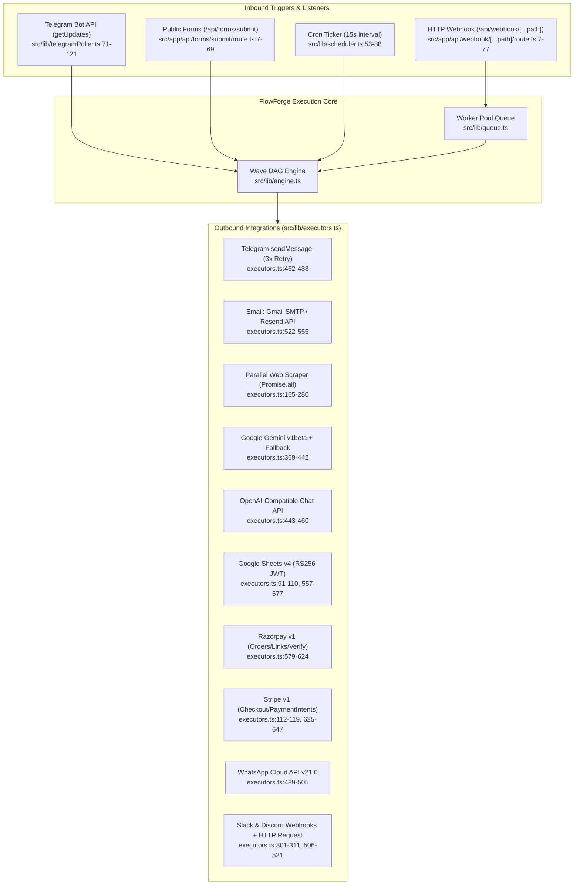

# 10 — External Integration Map

> **Stage 1 Discovery Artifact** · **Project**: FlowForge (`C:\Users\srira\.gemini\antigravity\scratch\flowforge`)  
> **Scope**: All inbound and outbound external integrations, protocols, endpoints, authentication mechanisms, retry/timeout policies, and secret key references (all secret values redacted).

---

## 1. Integration Architecture Overview

FlowForge integrates with external services across two primary runtime pathways:
1. **Inbound Triggers & Listeners**:
   - **Telegram 2-Way Long-Polling Listener** (`src/lib/telegramPoller.ts`, auto-started via `src/instrumentation.ts:6` and `GET /api/telegram` at `src/app/api/telegram/route.ts:10-16`).
   - **Dynamic HTTP Webhook Receiver** (`src/app/api/webhook/[...path]/route.ts:7-77`).
   - **Public Mini-App Form Receiver** (`src/app/api/forms/submit/route.ts:7-69`).
   - **Cron Schedule Ticker** (`src/lib/scheduler.ts:53-88`, auto-started via `src/instrumentation.ts:5`).
2. **Outbound Action Executors (`src/lib/executors.ts`)**:
   - All HTTP-based outbound integrations use either the shared `request(url, init)` helper (`src/lib/executors.ts:38-58`, which enforces a **60-second timeout** via `AbortSignal.timeout(60_000)` at `line 45`), custom `fetch` calls with explicit `AbortSignal.timeout(...)`, or `nodemailer` SMTP transport (`src/lib/executors.ts:541-553`).

---

## 2. Live 2-Way Telegram Bot Integration

FlowForge implements both **inbound message polling** (`telegram_trigger`) and **outbound message dispatch** (`telegram`).

### 2.1 Inbound Long-Polling Listener (`src/lib/telegramPoller.ts`)
- **Bootstrap**: Started automatically in Node.js runtime via `src/instrumentation.ts:1-8` (`startTelegramListener()`) and on UI load via `GET /api/telegram` (`src/app/api/telegram/route.ts:10-16`, called from `src/app/page.tsx:285`).
- **Global Singleton State (`src/lib/telegramPoller.ts:15-21`)**:
  Stored on `globalThis` (`__ffTgRunning`, `__ffTgOffset`, `__ffTgTimer`, `__ffTgBotInfo`, `__ffTgLogs`) to survive Next.js hot-reloads without spawning duplicate intervals.
- **Polling Cadence & Endpoints (`src/lib/telegramPoller.ts:71-129`)**:
  - `startTelegramListener()` (`lines 123-129`) sets `__ffTgRunning = true`, runs `pollOnce()` immediately, and registers `setInterval(pollOnce, 4500)` (every **4.5 seconds**).
  - **Bot Identity Discovery (`lines 76-88`)**: On first poll, calls `GET https://api.telegram.org/bot${token}/getMe` with `AbortSignal.timeout(6000)` and caches `{ username, firstName }` in `g.__ffTgBotInfo`.
  - **Update Fetching (`lines 90-106`)**: Calls `GET https://api.telegram.org/bot${token}/getUpdates?offset=${g.__ffTgOffset}&timeout=1` (or `?timeout=1` initially) with `AbortSignal.timeout(8000)`.
  - **Offset Advancement & Workflow Dispatch (`lines 108-117`)**: Advances `g.__ffTgOffset = upd.update_id + 1` (`line 109`) before calling `triggerTelegramWorkflows(...)` (`lines 31-69`).
- **Workflow Matching & Filter (`src/lib/telegramPoller.ts:44-65`)**:
  - Finds active workflows containing a `telegram_trigger` node (`lines 44-46`), falling back to the first workflow with a `telegram_trigger` node if none are marked active (`lines 48-50`).
  - Checks optional `trigNode.params.commandFilter`: if blank or `payload.text.toLowerCase().includes(filter.toLowerCase())` (`line 55`), executes `runWorkflow(targetWf, { mode: "telegram", triggerNodeId: trigNode?.id, triggerData: payload })` (`lines 56-60`).
  - Retains the latest **50 log entries** in `g.__ffTgLogs` (`line 67`) and returns the latest **30 entries** via `getTelegramStatus()` (`line 27`).

### 2.2 Outbound Telegram Sender (`src/lib/executors.ts:462-488`)
- **Node Type**: `telegram` (`mode: "each"`).
- **Endpoint**: `POST https://api.telegram.org/bot${botToken}/sendMessage` (`line 474`).
- **Credential Resolution (`lines 465-468`)**:
  - `botToken`: `s(p.botToken) || rc.secrets.TELEGRAM_BOT_TOKEN`
  - `chatId`: `s(p.chatId) || s(item?.json?.chatId) || rc.secrets.TELEGRAM_CHAT_ID`
- **Payload**: `{ chat_id: chatId, text: s(p.text), ...(s(p.parseMode) ? { parse_mode: s(p.parseMode) } : {}) }` (`line 476`). Supports `MarkdownV2` or `HTML` (`src/lib/nodes.ts:315-319`).
- **3x Retry Backoff (`lines 471-486`)**: Attempts up to 3 deliveries (`for (let attempt = 1; attempt <= 3; attempt++)`). On failure, waits `1000 * attempt` ms (`1000ms` after attempt 1, `2000ms` after attempt 2) before re-throwing `lastErr`.

---

## 3. Email Integration (Gmail SMTP & Resend REST API)

Implemented in the `email` executor (`src/lib/executors.ts:522-555`) with UI definitions in `src/lib/nodes.ts:375-403`.

| Provider Mode | Trigger Condition | Protocol / Endpoint | Authentication & Secret Keys | Implementation Details (`src/lib/executors.ts`) |
| :--- | :--- | :--- | :--- | :--- |
| **Gmail / Generic SMTP** (Default) | `p.provider !== "resend"` (`default: "gmail_smtp"`) | SMTPS via `nodemailer.createTransport` (`host: "smtp.gmail.com"`, `port: 465`, `secure: port === 465`) | `auth: { user: s(p.user), pass: s(p.pass) }` using `GMAIL_USER` (`SMTP_USER`) and `GMAIL_APP_PASSWORD` (`SMTP_PASS`) | Validates `need(p, "host", "user", "pass", "to")` (`line 539`). Sends via `transport.sendMail(...)` (`lines 547-552`) supporting plain `text` or `html` body (`line 551`). Returns `{ sent: true, provider: "gmail_smtp", messageId, accepted }` (`line 553`). |
| **Resend REST API** | `p.provider === "resend"` (`line 525`) | `POST https://api.resend.com/emails` (`line 527`) | `Authorization: Bearer <RESEND_API_KEY>` (`line 529`); `DEFAULT_FROM_EMAIL` or fallback `"FlowForge <onboarding@resend.dev>"` (`line 531`) | Validates `need(p, "resendApiKey", "to")` (`line 526`). Sends JSON `{ from, to: [s(p.to)], subject, text/html }` (`lines 530-535`). Returns `{ sent: true, provider: "resend", ...data }` (`line 537`). |

> **Note on Ethereal Test Fallback**: While the `D:\My n8n` prototype used Ethereal test accounts as a fallback, FlowForge (`src/lib/executors.ts:522-555`) executes direct live dispatch through `nodemailer` SMTP (`gmail_smtp`) or `api.resend.com` (`resend`) without an Ethereal fallback branch in `executors.ts`.

---

## 4. Parallel Multi-Website Scraper (`parallel_web`)

Implemented in `src/lib/executors.ts:165-280` (`mode: "each"`), configured in `src/lib/nodes.ts:106-157`.

- **URL Parsing & Validation (`lines 168-185`)**:
  - Accepts `p.urls ?? item.json.urls`, supporting JavaScript arrays, JSON-encoded array strings (`["https://..."]`), or newline/comma-delimited strings (`str.split(/[\r\n,]+/)`).
  - Filters for valid `^https?:\/\/` URLs (`line 184`) and throws if none are provided (`line 185`).
- **Concurrent Fetching (`lines 191-255`)**:
  - Executes all URLs simultaneously via `await Promise.all(urlList.map(async (url) => ...))` (`lines 191-192`).
  - Sends header `"user-agent": "FlowForge-ParallelBot/2.0"` with a **15-second per-URL timeout** (`AbortSignal.timeout(15_000)`, `lines 195-198`).
  - Measures per-site `latencyMs` using `performance.now()` (`lines 193, 199`).
- **Content Extraction Modes (`lines 187-236`)**:
  - **HTML Metadata (always attempted, `lines 219-224`)**: Extracts `<title>`, strips tags inside `<h1>`, and extracts `<meta name="description" content="...">`.
  - **`extract === "json"` or `application/json` content-type (`lines 208-213`)**: Parses response body with `JSON.parse(rawText)`, falling back to `rawText.slice(0, 300)`.
  - **`extract === "regex"` (`lines 215-218`)**: Evaluates `new RegExp(regexStr, "i").exec(rawText)` (default `<title>([^<]+)</title>`) and captures `m[1] ?? m[0]`.
  - **`preview` Fallback (`line 235`)**: Uses `extracted` or strips HTML tags and whitespace, truncating to 220 characters.
- **Error Isolation (`lines 237-253`)**: Individual site failures do not reject `Promise.all`; failed sites return `{ url, host, ok: false, status: 0, latencyMs, title: "ERROR", error: (err as Error).message }`.
- **Output Modes (`lines 257-278`)**:
  - `emitMode === "individual"` (`lines 265-267`): Fans out by returning `results` as an array of individual items (`Json[]`).
  - `emitMode === "summary_and_items"` (default, `lines 268-278`): Emits a single aggregated object containing `totalSites`, `healthyCount`, `failedCount`, `avgLatencyMs`, `parallelWallTimeMs`, `sequentialSumMs`, `speedupFactor` (`"${(sequentialSumMs / Math.max(parallelWallTimeMs, 1)).toFixed(1)}x faster in parallel"`), `summaryText`, and `results`.

---

## 5. AI Provider Integrations (`gemini` & `openai_chat`)

### 5.1 Google Gemini (`src/lib/executors.ts:369-442` & `src/app/api/ai-builder/route.ts:212-276`)
- **Endpoint**: `POST https://generativelanguage.googleapis.com/v1beta/models/${encodeURIComponent(model)}:generateContent` (`executors.ts:397`, `ai-builder/route.ts:219`).
- **Authentication**: Header `"x-goog-api-key": s(p.apiKey)` using `GEMINI_API_KEY` (`executors.ts:400`, `ai-builder/route.ts:224`).
- **Multi-Model Cascade (`executors.ts:373-374, 394-431`)**:
  - Tries candidate models in order: `[preferred ("gemini-2.5-flash"), "gemini-2.5-flash-lite", "gemini-2.0-flash", "gemini-flash-latest"]`.
  - Injects real-time IST date/time context (`runtimeContext`) into both `systemInstruction` and user `contents` (`lines 377-392`).
  - Supports structured JSON output when `p.jsonMode === true` via `generationConfig: { responseMimeType: "application/json" }` (`line 404`).
- **Adaptive Offline/503 Fallback (`executors.ts:432-440`)**:
  - If all candidate models fail (e.g., 503 capacity spike or quota limit), returns a synthetic live summary (`model: "gemini-adaptive-fallback"`) so downstream Telegram/Gmail/DB nodes in the workflow continue uninterrupted.
  - Similarly, `POST /api/ai-builder` falls back to deterministic keyword synthesis (`fallbackSynthesize(prompt)`, `src/app/api/ai-builder/route.ts:71-204, 278`) if Gemini API is unreachable or times out after 12s (`AbortSignal.timeout(12_000)`, `line 231`).

### 5.2 OpenAI-Compatible Chat (`src/lib/executors.ts:443-460`)
- **Endpoint**: `POST ${s(p.baseUrl).replace(/\/$/, "")}/chat/completions` (default `https://api.openai.com/v1/chat/completions`, or local Ollama via `OLLAMA_BASE_URL`, OpenRouter, Groq).
- **Authentication**: Optional `Authorization: Bearer ${s(p.apiKey)}` header using `OPENAI_API_KEY` (`line 449`).

---

## 6. Google Sheets Integration (`google_sheets`)

Implemented in `src/lib/executors.ts:87-110` and `557-577`.

- **Zero-SDK RS256 JWT OAuth2 Exchange (`googleAccessToken`, `lines 91-110`)**:
  1. Parses `credentials` (`GOOGLE_SERVICE_ACCOUNT` JSON string or object) and validates `client_email` and `private_key` (`lines 92-96`).
  2. Constructs JWT header `{ alg: "RS256", typ: "JWT" }` and claim `{ iss: sa.client_email, scope: "https://www.googleapis.com/auth/spreadsheets", aud: "https://oauth2.googleapis.com/token", iat: now, exp: now + 3600 }`, base64url-encoded (`lines 97-101`).
  3. Signs `${header}.${claim}` using Node's built-in `crypto.createSign("RSA-SHA256")` with `sa.private_key` (`line 102`).
  4. Exchanges the JWT assertion via `POST https://oauth2.googleapis.com/token` (`grant_type: "urn:ietf:params:oauth:grant-type:jwt-bearer"`, `lines 104-108`) and returns `access_token`.
- **Sheets v4 Operations (`lines 559-576`)**:
  - Base URL: `https://sheets.googleapis.com/v4/spreadsheets/${encodeURIComponent(spreadsheetId)}/values/${encodeURIComponent(range)}` (`line 562`).
  - **`operation === "read"` (`lines 564-568`)**: `GET ${base}` with `Authorization: Bearer ${token}`; maps header row `head` against subsequent rows into key-value objects.
  - **`operation === "append"` (`lines 569-575`)**: `POST ${base}:append?valueInputOption=USER_ENTERED&insertDataOption=INSERT_ROWS` with `{ values: [row] }`.

---

## 7. Payment Gateways (`razorpay` & `stripe`)

### 7.1 Razorpay (`src/lib/executors.ts:579-624`)
- **Authentication**:
  - REST API calls (`order`, `payment_link`, `fetch_payment`): HTTP Basic Auth `Authorization: Basic base64(keyId:keySecret)` (`line 592`) using `RAZORPAY_KEY_ID` and `RAZORPAY_KEY_SECRET`.
  - Webhook verification (`verify`): HMAC-SHA256 using `RAZORPAY_WEBHOOK_SECRET` (`lines 582-590`).
- **Operations**:
  - **`verify` (`lines 582-590`)**: Computes `crypto.createHmac("sha256", webhookSecret).update(raw).digest("hex")` against `rc.trigger.headers["x-razorpay-signature"]` using constant-time `crypto.timingSafeEqual` (`line 588`).
  - **`fetch_payment` (`lines 594-597`)**: `GET https://api.razorpay.com/v1/payments/${encodeURIComponent(paymentId)}`.
  - **`order` (`lines 598-606`)**: `POST https://api.razorpay.com/v1/orders` with `{ amount: Math.round(Number(p.amount) * 100), currency: "INR", receipt: "ff_<timestamp>", notes }`.
  - **`payment_link` (default, `lines 607-622`)**: `POST https://api.razorpay.com/v1/payment_links` with `{ amount: paise, currency: "INR", description, customer, notify: { sms, email } }`.

### 7.2 Stripe (`src/lib/executors.ts:112-119, 625-647`)
- **Authentication**: `Authorization: Bearer ${s(p.secretKey)}` (`STRIPE_SECRET_KEY`) with `Content-Type: application/x-www-form-urlencoded` (`line 629`).
- **Nested Form Serialization (`stripeForm`, `lines 112-119`)**: Recursively flattens nested objects into bracket notation (e.g., `line_items[0][price_data][unit_amount]`) into a `URLSearchParams` body.
- **Operations**:
  - **`fetch_intent` (`lines 630-633`)**: `GET https://api.stripe.com/v1/payment_intents/${encodeURIComponent(intentId)}`.
  - **`checkout` (default, `lines 634-645`)**: `POST https://api.stripe.com/v1/checkout/sessions` with `mode: "payment"`, `success_url`, `cancel_url`, and `line_items[0]`.

---

## 8. Messaging, Webhooks & System I/O Integrations

| Node Type | Category | Endpoint / Mechanism | Authentication / Secret Keys | Source Reference |
| :--- | :--- | :--- | :--- | :--- |
| **`whatsapp`** | Messaging | `POST https://graph.facebook.com/v21.0/${phoneNumberId}/messages` | `Authorization: Bearer <WHATSAPP_TOKEN>`, `WHATSAPP_PHONE_ID` | `src/lib/executors.ts:489-505` (supports `kind === "text"` and `kind === "template"`). |
| **`slack`** | Messaging | `POST <webhookUrl>` | Pre-signed Incoming Webhook URL (`SLACK_WEBHOOK_URL`) | `src/lib/executors.ts:506-513` (sends `{ text }`). |
| **`discord`** | Messaging | `POST <webhookUrl>` | Pre-signed Webhook URL (`DISCORD_WEBHOOK_URL`) | `src/lib/executors.ts:514-521` (sends `{ content, username }`). |
| **`http_request`** | Core | `GET \| POST \| PUT \| PATCH \| DELETE <url>` | Custom JSON headers (`p.headers`) | `src/lib/executors.ts:301-311` (60s timeout via `request()`). |
| **`webhook_trigger`** | Triggers | Inbound `ANY / GET / POST / PUT / PATCH / DELETE /api/webhook/[...path]` | Path/method matching on active workflows (optional downstream `razorpay` `verify` HMAC check) | `src/app/api/webhook/[...path]/route.ts:7-77` (supports `respond: "immediately"` HTTP 202 or `respond: "lastNode"` HTTP 200). |
| **`form_trigger`** | Triggers | Inbound `POST /api/forms/submit` | Internal / Public Mini-App JSON POST | `src/app/api/forms/submit/route.ts:7-69` (auto-inserts to `dbTables` and runs matching workflow). |
| **`read_file` / `write_file`** | System | Local filesystem `fs.readFile` / `fs.writeFile` / `fs.appendFile` | OS process permissions (`path.resolve(s(p.path))`) | `src/lib/executors.ts:649-672`. |
| **`exec`** | System | Child process shell execution via `child_process.exec` | OS process permissions (`cwd`, `timeout` default 60s, `maxBuffer: 10MB`) | `src/lib/executors.ts:673-690`. |

---

## 9. Complete Secret Keys Reference Matrix (Names Only)

All 15 preset secret keys surfaced in the FlowForge Secrets Vault UI (`PRESET_SECRET_KEYS` in `src/app/page.tsx:61-77`) plus `.env` aliases:

| Secret Key Name | Integration / Node Type | Default Expression in Node Catalog (`src/lib/nodes.ts`) |
| :--- | :--- | :--- |
| `GEMINI_API_KEY` | Gemini AI (`gemini`), AI Workflow Builder (`/api/ai-builder`) | `{{ $secrets.GEMINI_API_KEY }}` (`nodes.ts:275`) |
| `OPENAI_API_KEY` | OpenAI-compatible LLM (`openai_chat`) | `{{ $secrets.OPENAI_API_KEY }}` (`nodes.ts:291`) |
| `RESEND_API_KEY` | Email via Resend (`email`) | `{{ $secrets.RESEND_API_KEY }}` (`nodes.ts:396`) |
| `GMAIL_USER` | Email via Gmail SMTP (`email`) | `{{ $secrets.GMAIL_USER }}` (`nodes.ts:394, 398`) |
| `GMAIL_APP_PASSWORD` | Email via Gmail SMTP (`email`) | `{{ $secrets.GMAIL_APP_PASSWORD }}` (`nodes.ts:395`) |
| `DEFAULT_FROM_EMAIL` | Email sender address (`email`) | `{{ $secrets.DEFAULT_FROM_EMAIL }}` (`nodes.ts:397`) |
| `TELEGRAM_BOT_TOKEN` | Telegram Sender (`telegram`) & Poller (`telegramPoller.ts`) | `{{ $secrets.TELEGRAM_BOT_TOKEN }}` (`nodes.ts:307`) |
| `TELEGRAM_CHAT_ID` | Telegram Sender (`telegram`) & Trigger fallback (`telegram_trigger`) | `{{ $secrets.TELEGRAM_CHAT_ID }}` (`nodes.ts:308`) |
| `WHATSAPP_TOKEN` | WhatsApp Cloud API (`whatsapp`) | `{{ $secrets.WHATSAPP_TOKEN }}` (`nodes.ts:331`) |
| `WHATSAPP_PHONE_ID` | WhatsApp Cloud API (`whatsapp`) | `{{ $secrets.WHATSAPP_PHONE_ID }}` (`nodes.ts:332`) |
| `SLACK_WEBHOOK_URL` | Slack Incoming Webhook (`slack`) | `{{ $secrets.SLACK_WEBHOOK_URL }}` (`nodes.ts:357`) |
| `DISCORD_WEBHOOK_URL` | Discord Webhook (`discord`) | `{{ $secrets.DISCORD_WEBHOOK_URL }}` (`nodes.ts:369`) |
| `GOOGLE_SERVICE_ACCOUNT` | Google Sheets v4 (`google_sheets`) | `{{ $secrets.GOOGLE_SERVICE_ACCOUNT }}` (`nodes.ts:461`) |
| `RAZORPAY_KEY_ID` | Razorpay Orders / Links (`razorpay`) | `{{ $secrets.RAZORPAY_KEY_ID }}` (`nodes.ts:489`) |
| `RAZORPAY_KEY_SECRET` | Razorpay Orders / Links (`razorpay`) | `{{ $secrets.RAZORPAY_KEY_SECRET }}` (`nodes.ts:490`) |
| `RAZORPAY_WEBHOOK_SECRET` | Razorpay Webhook Verification (`razorpay` `verify`) | `{{ $secrets.RAZORPAY_WEBHOOK_SECRET }}` (`nodes.ts:509`) |
| `STRIPE_SECRET_KEY` | Stripe Checkout / Intents (`stripe`) | `{{ $secrets.STRIPE_SECRET_KEY }}` (`nodes.ts:520`) |
