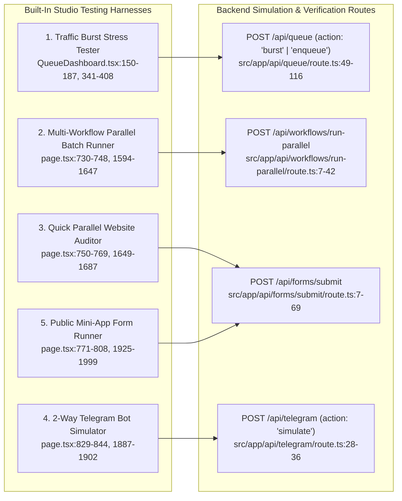

# 11 — Testing & Verification Overview

> **Stage 1 Discovery Artifact** · **Project**: FlowForge (`C:\Users\srira\.gemini\antigravity\scratch\flowforge`)  
> **Scope**: Audit of automated test suites, interactive built-in UI testing harnesses, API-level verification endpoints, and Playwright / browser verification status.

---

## 1. Automated Test Suite Audit

A full recursive inventory of `C:\Users\srira\.gemini\antigravity\scratch\flowforge` and `package.json` (`lines 1-30`) confirms:

| Test Category | Present in Repository? | Evidence & Findings |
| :--- | :---: | :--- |
| **Unit Tests** (`*.test.ts`, `*.spec.ts`, Jest, Vitest, Node `node:test`) | **No** (`0` files) | No `*.test.*` or `*.spec.*` files exist in `src/` or the project root. `package.json:5-10` defines only `"dev"`, `"build"`, `"start"`, and `"lint"` scripts; no `"test"` script is configured. |
| **Integration Test Scripts** (Supertest, Postman collections) | **No** (`0` files) | No standalone test runner packages exist in `dependencies` or `devDependencies` (`package.json:11-29`). |
| **End-to-End (E2E) Config** (`playwright.config.ts`, `cypress.config.ts`) | **No** (`0` config files in repo) | `@playwright/test` is not listed in `package.json:11-29`. Instead, interactive verification harnesses are embedded directly into the Next.js Studio UI and REST API endpoints, and ad-hoc verification was conducted during swarm builds using `npx tsc --noEmit`, `next build`, REST API calls (`/api/queue`, `/api/telegram`, `/api/forms/submit`), and live browser inspection. |
| **Static Type & Lint Verification** | **Yes** | TypeScript 5 (`tsconfig.json`, strict mode enabled) and ESLint 9 (`eslint.config.mjs` with `eslint-config-next: 16.4.6`). |

---

## 2. Built-In Interactive Testing & Simulation Harnesses

Instead of external test files, FlowForge embeds **five interactive testing and simulation harnesses** directly inside the Studio Console (`src/app/page.tsx` and `src/components/QueueDashboard.tsx`) backed by dedicated API routes.

### 2.1 Queue Burst Stress Tester & Priority Enqueuer (`src/components/QueueDashboard.tsx`)
- **UI Location**: Bottom Telemetry Dock → `⚡ Queue & Worker Pool` tab (`src/app/page.tsx:1582-1589`, rendered by `src/components/QueueDashboard.tsx:242-667`).
- **Capabilities**:
  - **Mode Toggle (`QueueDashboard.tsx:269-294`)**: Switches live between `parallel_pool` (multi-worker concurrent execution) and `sequential_fifo` (strict 1-by-1 FIFO execution) via `POST /api/queue` with `{ action: "config", mode, concurrency }` (`lines 128-148`).
  - **Concurrency Slider (`lines 300-339`)**: Adjusts worker pool size dynamically from `1x` to `16x` in the UI (backend supports `1..20` at `src/lib/queue.ts:91, 378`).
  - **Traffic Burst Generator (`lines 150-187, 341-408`)**: Fires `5x`, `10x`, or `20x` simultaneous workflow requests via `POST /api/queue` with `{ action: "burst", burstCount, workflowIds }`.
  - **Backend Burst Engine (`src/lib/queue.ts:229-283` & `src/app/api/queue/route.ts:77-116`)**:
    - `enqueueBurstRuns()` assigns rotating priorities `1..3` (`(idx % 3) + 1`, `queue.ts:250`) to demonstrate priority scheduling under load, enforces a minimum simulated slot hold time of `minSimMs: 220` (`queue.ts:148-150, 262`) so active worker slots are visually observable in the UI, and measures total `parallelWallTimeMs`.
  - **Single Priority Job Injection (`QueueDashboard.tsx:189-210, 381-393`)**: The `+1 Priority` button enqueues a single high-priority (`priority: 10`) job with `wait: false` to test priority preemption over queued burst jobs.

### 2.2 Multi-Workflow Parallel Batch Runner (`src/app/page.tsx`)
- **UI Location**: Bottom Telemetry Dock → `⚡ Queue & Worker Pool` tab → `Multi-Workflow Parallel Batch (Promise.all)` card (`src/app/page.tsx:1593-1647`).
- **Handler (`src/app/page.tsx:730-748`)**: Calls `POST /api/workflows/run-parallel` (`src/app/api/workflows/run-parallel/route.ts:7-42`) with `{ workflowIds: selectedBatchWfs }`, which enqueues all selected workflows concurrently via `Promise.all` (`route.ts:25-34`) and reports `{ totalWorkflows, parallelWallTimeMs, executions, jobs }`.

### 2.3 Quick Parallel Website Health & Scraper Harness (`src/app/page.tsx`)
- **UI Location**: Bottom Telemetry Dock → `⚡ Queue & Worker Pool` tab → `Parallel Website Health & Scraper` card (`src/app/page.tsx:1649-1687`).
- **Handler (`src/app/page.tsx:750-769`)**: Sends a list of newline-separated URLs (`quickUrls`, initialized with 5 live URLs at `lines 174-176`) to `POST /api/forms/submit` with `formSlug: "parallel-websites"` and renders the live JSON result (`quickWebResult`) inline.

### 2.4 2-Way Telegram Bot Simulator (`src/app/page.tsx` & `src/app/api/telegram/route.ts`)
- **UI Location**: Bottom Telemetry Dock → `💬 Telegram & Forms` tab → `2-Way Telegram Bot Listener` card (`src/app/page.tsx:1862-1922`).
- **Handler (`src/app/page.tsx:829-844`)**: `simulateTelegramIncoming()` sends `POST /api/telegram` with `{ action: "simulate", text: tgSimText, fromName: "Sriram" }`.
- **Backend Execution (`src/app/api/telegram/route.ts:28-36` & `src/lib/telegramPoller.ts:31-69`)**:
  - Synthesizes an incoming Telegram message payload using `sec.TELEGRAM_CHAT_ID || "1979386706"` (`route.ts:32`) and invokes `triggerTelegramWorkflows(...)` (`telegramPoller.ts:31`).
  - Matches active workflows containing a `telegram_trigger` node (such as `wf-telegram-bot-responder`), runs the Gemini AI responder, dispatches a real outbound reply to Telegram (`tb-reply`), logs the chat into the `ai_logs` database table (`tb-db`), and appends the event to `g.__ffTgLogs`.

### 2.5 Public Mini-Apps & Form Trigger Tester (`src/app/page.tsx` & `src/app/api/forms/submit/route.ts`)
- **UI Location**: Bottom Telemetry Dock → `💬 Telegram & Forms` tab → `Mini-Apps & Public Forms` card (`src/app/page.tsx:1925-1999`).
- **Supported Form Slugs (`src/app/page.tsx:771-808, 1931-1936` & `src/app/api/forms/submit/route.ts:17-22`)**:
  1. `parallel-websites` → inserts into `website_monitors` table and overrides `parallel_web` node URLs (`route.ts:42-48`).
  2. `lead-capture` → inserts into `leads` table and overrides `gemini` prompt (`route.ts:49-56`).
  3. `order-checkout` → inserts into `orders` table and overrides `gemini` prompt.
  4. `ask-ai` → inserts into `ai_logs` table and overrides `gemini` prompt.

### 2.6 Node-Level Partial Execution & Payload Seeding
- **Manual Trigger Sample Payload (`src/lib/nodes.ts:17`, `src/lib/executors.ts:123-128`)**: Every `manual_trigger` node includes a `sample` JSON parameter that seeds the initial `Item` for manual test runs.
- **Run From Specific Trigger Node (`src/components/Inspector.tsx:259-266`, `src/app/page.tsx:441-467`)**: Clicking the play button inside the Node Inspector on any trigger node invokes `handleRun(selectedWfNode.id)`, passing `triggerNodeId` to `POST /api/workflows/[id]/run` (`src/app/api/workflows/[id]/run/route.ts:10-21`) to test a specific trigger entry point.

---

## 3. Historical Execution & Verification Evidence on Disk

Inspection of `data/db.json` and `data/files/` confirms extensive live execution testing has already been performed against this workspace:
- **`data/db.json`**: Contains **70 recorded workflow executions** across manual, telegram, form, and `parallel_batch` modes, and **50 persisted database records** across `website_monitors`, `leads`, `orders`, and `ai_logs`.
- **`data/files/parallel-websites.jsonl`**: Contains **7 JSONL audit lines** (`13,694` bytes) from live parallel 5-website scraping runs, including a verified timeout test case (`https://palvaram-web.onrender.com` aborting cleanly at `15022ms` via the 15s `AbortSignal.timeout(15_000)` guard on line 7).
- **`data/files/top-users.jsonl`**: Contains **24 JSONL records** (`4,680` bytes) generated by `wf-demo-api-pipeline` (`Fetch Users API → Check User ID <= 3 → Enrich Top Users → Save Top Users Log`).
