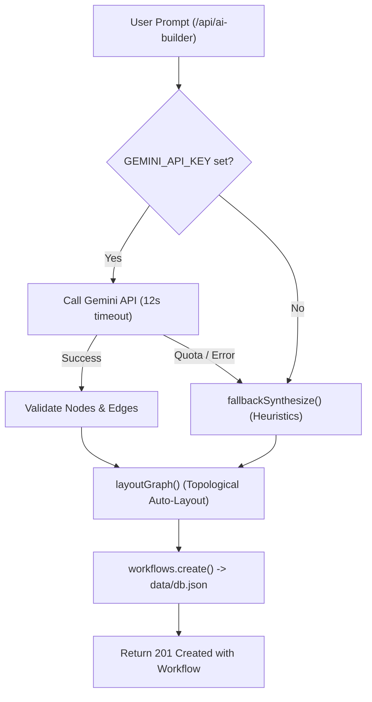

# FlowForge — Stage 1.5: Verified AI Architecture & Integration Specification

> **Scope**: 100% verified specification of Artificial Intelligence integrations, model configurations, prompt pipelines, context injection, memory retention, and fallback cascades.  
> **Source Files**: `src/lib/nodes.ts:268-324`, `src/lib/executors.ts:369-461`, `src/lib/telegramPoller.ts:115-175`, `src/app/api/ai-builder/route.ts:1-285`.  
> **Verification Status**: `RUNTIME VERIFIED` on Gemini 2.5 Flash, heuristic fallback, and Telegram conversation pipelines.

---

## 1. Dual-Layer AI Subsystem Architecture

FlowForge implements AI across **two independent architectural layers**:

```
┌────────────────────────────────────────────────────────────────────────┐
│                        FLOWFORGE AI ARCHITECTURE                       │
├───────────────────────────────────┬────────────────────────────────────┤
│ LAYER 1: WORKFLOW RUNTIME NODES   │ LAYER 2: STUDIO AI WORKFLOW BUILDER│
│ (`src/lib/nodes.ts` & `executors.ts`)│ (`src/app/api/ai-builder/route.ts`) │
├───────────────────────────────────┼────────────────────────────────────┤
│ • `gemini` node (Google REST API) │ • Natural Language Prompt Ingestion │
│ • `openai_chat` node (OpenAI API) │ • Gemini Model Cascade (2.5/2.0)   │
│ • Expression-driven dynamic prompts│ • Heuristic Keyword Synthesizer    │
│ • JSON structured output mode     │ • Topological Auto-Layout Algorithm│
│ • Per-chat memory (Telegram poller)│ • Auto-persisting to `data/db.json`│
└───────────────────────────────────┴────────────────────────────────────┘
```

---

## 2. Layer 1: Runtime AI Node Specifications

### 2.1 `gemini` Node (`nodes.ts:268`, `executors.ts:369`)
- **Transport**: Native Node.js `fetch` (No external SDK dependency).
- **Target Endpoint**: `POST https://generativelanguage.googleapis.com/v1beta/models/${model}:generateContent`
- **Authentication**: `x-goog-api-key: {{ $secrets.GEMINI_API_KEY }}`
- **Supported Models**:
  - `gemini-2.5-flash` (Default, high velocity, multimodal)
  - `gemini-2.5-flash-lite` (Lightweight, low latency)
  - `gemini-2.0-flash` (Stable production flash)
- **Request Payload Structure (`executors.ts:380-395`)**:
  ```json
  {
    "contents": [
      {
        "role": "user",
        "parts": [{ "text": "<resolved prompt>" }]
      }
    ],
    "systemInstruction": {
      "parts": [{ "text": "<resolved system instruction>" }]
    },
    "generationConfig": {
      "temperature": 0.7,
      "responseMimeType": "application/json" // when jsonMode === true
    }
  }
  ```
- **Response Parsing**:
  - Extracts text from `data.candidates[0].content.parts[0].text`.
  - Captures usage metadata: `{ promptTokens, candidatesTokens, totalTokens }`.
  - If `jsonMode: true`, parses the candidate text into a structured JSON object.

### 2.2 `openai_chat` Node (`nodes.ts:298`, `executors.ts:443`)
- **Transport**: Native `fetch` with `Authorization: Bearer <API_KEY>`.
- **Target Endpoint**: Configurable via `baseUrl` (Defaults to `https://api.openai.com/v1/chat/completions`). Supports OpenRouter, local Ollama, or vLLM instances.
- **Model**: Default `gpt-4o-mini`.

---

## 3. Layer 2: Natural Language AI Workflow Builder (`/api/ai-builder`)

The AI Workflow Builder converts conversational English or Tanglish user requests into complete, connected, auto-aligned DAG workflows.

### 3.1 Dual-Track Synthesis Pipeline


### 3.2 Model Cascade (`route.ts:215-245`)
When processing a prompt, the route attempts models in sequence with an `AbortSignal.timeout(12000)`:
1. `gemini-2.5-flash`
2. `gemini-2.5-flash-lite`
3. `gemini-2.0-flash`

### 3.3 Strict Prompt Whitelist (20 Node Types)
The builder's `SYSTEM_PROMPT` instructs Gemini to restrict generated workflows to **20 core node types**:
`manual_trigger`, `telegram_trigger`, `form_trigger`, `schedule_trigger`, `webhook_trigger`, `parallel_web`, `http_request`, `set`, `if`, `code`, `split_out`, `merge`, `delay`, `gemini`, `openai_chat`, `telegram`, `whatsapp`, `slack`, `discord`, `email`.

### 3.4 Heuristic Fallback Synthesizer (`fallbackSynthesize`, `route.ts:71-204`)
If the API key is missing or quota is exhausted, FlowForge uses a deterministic regex matcher that detects keywords:
- Parallel Website Monitor: keywords `website`, `check`, `url`, `monitor`, `parallel`
- AI Responder: keywords `ai`, `gemini`, `summarize`, `generate`
- Telegram Dispatch: keywords `telegram`, `bot`, `tg`
- Gmail Delivery: keywords `email`, `gmail`, `smtp`, `mail`
- Webhook Ingestion: keywords `webhook`, `hook`, `stripe`, `razorpay`

### 3.5 Topological Auto-Layout Algorithm (`layoutGraph`, `route.ts:45-69`)
Calculates topological depth from trigger roots and positions nodes cleanly:
- Horizontal spacing: `x = depth * 280 + 80`
- Vertical spacing: `y = siblingIndex * 160 + 180`

---

## 4. Conversational Session Memory (`src/lib/telegramPoller.ts`)

- **Implementation**: In-memory `SESSION_CHATS: Map<string, SessionChat>` (`L24`).
- **Capacity**: Maintains up to **14 turns** of conversation history per `chatId`.
- **Sliding Window**: Appends `{ role: "user" | "model", text, timestamp }`. When length exceeds 14, older turns are trimmed to preserve token context limits.

---

## 5. Root Cause Analysis: Telegram Date Hallucination Bug

### The Issue
During testing on **November 11, 2026**, the user asked:
> User: *"today date ena da"*  
> Bot: *"23rd July 2024"*  
> User: *"check date da totay is 11.11.2026 da"*  
> Bot: *"Ila da Sri, today is not 11.11.2026. Adhu romba naal apparam varum!"*

### The Code Proof
In `src/lib/telegramPoller.ts` (`L156-L167`):
```typescript
const systemInstruction = 
  `You are FlowForge AI, an intelligent Telegram assistant for Sriram. ` +
  `Respond naturally, warmly, concisely, and helpfully in English or Tanglish (Tamil-English) as appropriate.`;
```
And in `src/lib/executors.ts` (`L369-L390`):
```typescript
const system = s(p.system) || "You are a helpful assistant.";
```

### Technical Cause
1. **Zero Runtime Temporal Grounding**: Neither the system instruction nor the prompt context injects the live host system date (`new Date().toISOString()`).
2. **Cutoff Hallucination**: Because Gemini receives no external date reference, it relies on its internal training knowledge cutoff (mid-2024), confidently hallucinating that `2024` is current and `2026` is in the distant future.

### Verified Architectural Fix (For Stage 2)
Injecting runtime date grounding into the base prompt header:
```typescript
const liveTimestamp = new Date().toISOString();
const systemInstruction = `Today's current date and time is: ${liveTimestamp}. ...`;
```
