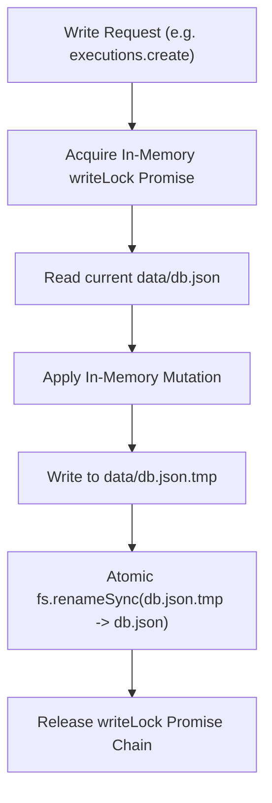

# FlowForge — Stage 1.5: Verified Database & Storage Architecture

> **Scope**: 100% verified specification of persistence mechanisms, storage schemas, serialization locks, backup policies, secret synchronization, and collection models.  
> **Source Files**: `src/lib/store.ts:1-295`, `src/lib/templates.ts:1-180`, `src/lib/types.ts:57-103`.  
> **Verification Status**: `STATICALLY VERIFIED` and `RUNTIME VERIFIED`.

---

## 1. Storage Architecture Overview

FlowForge is architected with a **zero-dependency, file-backed atomic JSON document store** located at:
`C:\Users\srira\.gemini\antigravity\scratch\flowforge\data\db.json`

No external database server (PostgreSQL, MySQL, Redis, SQLite) is required to run FlowForge.

```
data/
├── db.json                     <-- Main persistent JSON state
├── db.json.tmp                 <-- Atomic write staging file
├── backups/                    <-- Timestamped JSON state backups
└── files/                      <-- Storage directory for read_file / write_file nodes
```

---

## 2. Storage Collections & Schemas (`data/db.json`)

The root JSON document contains four primary collections:

```typescript
interface DatabaseSchema {
  workflows: Workflow[];
  executions: Execution[];
  dbTables: Record<string, DbRecord[]>;
  secrets: Record<string, string>;
}
```

### 2.1 `workflows` Collection (`store.ts:150-210`)
Stores all DAG workflow definitions:
```typescript
interface Workflow {
  id: string; // crypto.randomUUID() or preset key (e.g. "wf-parallel-multi-website")
  name: string;
  active: boolean; // Controls whether schedules, webhooks, and telegram triggers respond
  nodes: WorkflowNode[];
  edges: WorkflowEdge[];
  createdAt: string; // ISO 8601
  updatedAt: string; // ISO 8601
}
```
- **Seeding Rule (`store.ts:105-115`)**: If `data/db.json` is missing or empty, `workflows.list()` automatically seeds the 4 starter templates defined in `src/lib/templates.ts`.

### 2.2 `executions` Collection (`store.ts:215-245`)
Maintains an append-only log of execution runs:
```typescript
interface Execution {
  id: string; // "exec_<timestamp>_<uuid>"
  workflowId: string;
  workflowName: string;
  mode: "manual" | "schedule" | "webhook" | "telegram" | "form" | "parallel_batch";
  status: "running" | "success" | "error";
  startedAt: string;
  finishedAt?: string;
  error?: string;
  nodes: Record<string, NodeRunResult>;
}
```
- **Retention Cap**: To prevent unbounded file growth, `executions.create()` automatically caps the execution log to the **latest 200 records**, dropping older executions.

### 2.3 `dbTables` Collection (`store.ts:270-295`)
Provides an internal multi-table NoSQL document database:
- Supported operations:
  - `insert(table, data)`: Generates `id: crypto.randomUUID()`, `createdAt: ISO`, and appends to `dbTables[table]`.
  - `list(table, limit = 25)`: Returns most recent records in table.
  - `clear(table)`: Empties all records in the specified table.
- Default tables created by starters: `website_monitors`, `leads`, `ai_logs`.

### 2.4 `secrets` Collection (`store.ts:250-268`)
Key-value vault storing API keys and credentials:
- Masking: In API responses (`GET /api/secrets`), secret values are masked (`sk-***`).
- **External Environment Merging (`syncExternalEnv`, `store.ts:61-69`)**:
  On every read operation, FlowForge checks if `D:\My n8n\.env` exists. If present, it parses any unmasked keys (`GEMINI_API_KEY`, `TELEGRAM_BOT_TOKEN`, `TELEGRAM_CHAT_ID`, `OPENAI_API_KEY`) and merges them into the memory store.

---

## 3. Concurrency Protection & Atomic Write Mutex

Because multiple route handlers and background pollers may attempt to write to `data/db.json` simultaneously, `src/lib/store.ts` enforces serialization:



1. **In-Memory Lock**: `writeLock = writeLock.then(async () => { ... })` ensures that only one write executes at any time within the Node.js process.
2. **Atomic Swap**: Writing to a `.tmp` file and renaming prevents corrupted half-written files if the server is stopped during a write operation.
