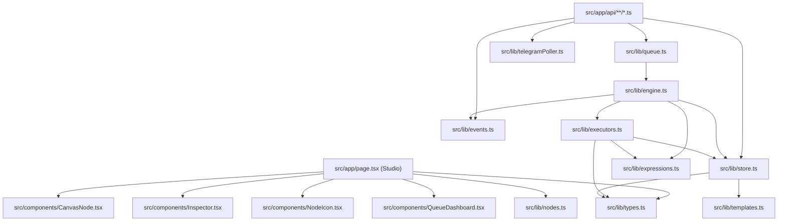

# FlowForge — Stage 1.5: Verified Dependency & Integration Graph

> **Scope**: Exhaustive inventory of all production packages, development tools, Node.js built-ins, internal import trees, and external third-party network endpoints.  
> **Source Files**: `package.json:1-30`, `tsconfig.json`, `src/lib/*.ts`, `src/app/api/**/*.ts`.  
> **Verification Status**: `STATICALLY VERIFIED` across all modules.

---

## 1. NPM Package Dependencies (`package.json`)

### 1.1 Production Dependencies
| Package | Version in `package.json` | Purpose | Source Import Locations |
| :--- | :--- | :--- | :--- |
| `next` | `16.4.6` | App Router framework, Route Handlers, Turbopack dev server. | `next/server` (`NextResponse`, `NextRequest`), `next/font` |
| `react` | `19.3.0` | React core library. | `src/app/page.tsx`, `src/components/*.tsx` |
| `react-dom` | `19.3.0` | React DOM renderer. | `src/app/layout.tsx` |
| `@xyflow/react` | `^12.12.1` | React Flow library for interactive canvas DAG visualization. | `src/app/page.tsx`, `src/components/CanvasNode.tsx` |
| `lucide-react` | `^1.71.0` | UI icon pack for node palette, status badges, and dock tabs. | `src/components/NodeIcon.tsx`, `src/app/page.tsx` |
| `nodemailer` | `^10.3.1` | SMTP email transport client for Gmail/custom SMTP delivery. | `src/lib/executors.ts:536` (`email` node) |
| `@types/nodemailer`| `^8.0.2` | TypeScript type declarations for nodemailer. | Build-time type resolution |

### 1.2 Development Dependencies
| Package | Version in `package.json` | Purpose |
| :--- | :--- | :--- |
| `tailwindcss` | `4.3.3` | Utility-first CSS styling engine. |
| `@tailwindcss/turbopack` | `4.3.3` | Turbopack compilation plugin for Tailwind CSS v4. |
| `typescript` | `^5` | Static type checker. |
| `eslint` | `^9` | Code linter. |
| `eslint-config-next` | `16.4.6` | Next.js linting configuration rules. |
| `@types/node` | `^20` | Node.js standard library type definitions. |
| `@types/react` | `^19` | React 19 type definitions. |
| `@types/react-dom` | `^19` | React DOM 19 type definitions. |

---

## 2. Node.js Built-In Standard Library Dependencies

FlowForge leverages native Node.js core modules (`node:*`) rather than bulky third-party dependencies:

| Module | Exact Sub-Imports | Usage in FlowForge | Source File & Line |
| :--- | :--- | :--- | :--- |
| `node:fs` | `existsSync`, `readFileSync`, `writeFileSync`, `mkdirSync` | File-system checks, starter workflow seeding, secret syncing. | `src/lib/store.ts:6-14` |
| `node:fs/promises` | `readFile`, `writeFile`, `appendFile`, `mkdir` | Non-blocking file I/O for `read_file` and `write_file` nodes. | `src/lib/executors.ts:650,663` |
| `node:path` | `join`, `resolve`, `dirname` | Cross-platform file path resolution for `data/` storage. | `src/lib/store.ts:8`, `executors.ts:651` |
| `node:crypto` | `randomUUID`, `createSign`, `createHmac` | Execution/node UUIDs, Google RS256 JWT, Razorpay HMAC-SHA256 verification. | `src/lib/store.ts:124`, `executors.ts:95,618` |
| `node:events` | `EventEmitter` | Global in-memory pub-sub event bus for live workflow streaming. | `src/lib/events.ts:11` |
| `node:vm` | `Script`, `createContext` | Isolated JS sandbox for `code` node and dynamic `{{ }}` expressions. | `src/lib/expressions.ts:18`, `executors.ts:245` |
| `node:child_process` | `exec` | Shell command execution for system administration node `exec`. | `src/lib/executors.ts:674` |

---

## 3. Internal Module Dependency Graph

---

## 4. External Network Services & Endpoints

| Target Service | Protocol / Endpoint | Associated Node / Module | Authentication Mechanism |
| :--- | :--- | :--- | :--- |
| **Google Gemini API** | `POST https://generativelanguage.googleapis.com/v1beta/models/...` | `gemini` node, `/api/ai-builder` | `x-goog-api-key` header (`GEMINI_API_KEY`) |
| **Telegram Bot API** | `POST https://api.telegram.org/bot<TOKEN>/...` | `telegram` node, `telegramPoller.ts` | Bot token in URL path |
| **OpenAI / OpenRouter** | `POST https://api.openai.com/v1/chat/completions` | `openai_chat` node | `Bearer <OPENAI_API_KEY>` |
| **Meta WhatsApp API** | `POST https://graph.facebook.com/v21.0/.../messages` | `whatsapp` node | `Bearer <WHATSAPP_TOKEN>` |
| **Slack Webhooks** | `POST https://hooks.slack.com/services/...` | `slack` node | Webhook URL token |
| **Discord Webhooks** | `POST https://discord.com/api/webhooks/...` | `discord` node | Webhook URL token |
| **Resend Email API** | `POST https://api.resend.com/emails` | `email` node (Resend mode) | `Bearer <RESEND_API_KEY>` |
| **Google OAuth2 / Sheets** | `POST https://oauth2.googleapis.com/token` & `sheets.googleapis.com` | `google_sheets` node | RS256 signed JWT exchange |
| **Razorpay Payments** | `POST https://api.razorpay.com/v1/...` | `razorpay` node | HTTP Basic Auth (`Key ID` + `Key Secret`) |
| **Stripe Payments** | `POST https://api.stripe.com/v1/...` | `stripe` node | `Bearer <STRIPE_SECRET_KEY>` |

---

## 5. Architectural Comparison: FlowForge vs. `D:\My n8n` (FlowCraft)

| Dimension | FlowForge (`scratch/flowforge`) | FlowCraft (`D:\My n8n`) |
| :--- | :--- | :--- |
| **Package Name** | `flowforge@0.1.0` | `flowcraft@0.1.0` |
| **Canvas Technology** | `@xyflow/react` 12.12.1 (Full node-graph canvas) | Custom DOM canvas + `canvas-confetti` |
| **Database Engine** | Local zero-config atomic `data/db.json` | `mysql2` driver targeting external MySQL instance |
| **Node Registry** | 27 registered node definitions & executors | Basic prototype node set |
| **Cross-Link** | Reads `D:\My n8n\.env` as fallback secret source | Standalone `.env` host |
