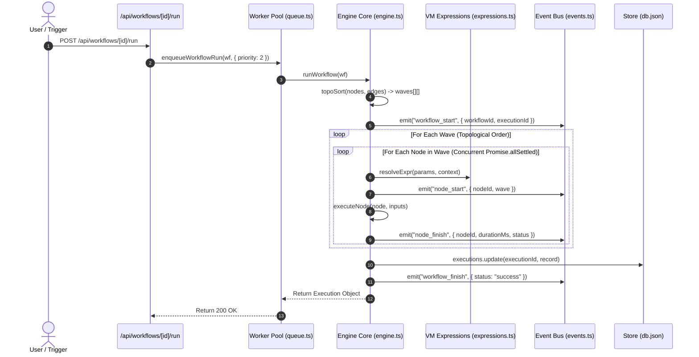

# FlowForge — Stage 1.5: Verified Workflow Execution Architecture

> **Scope**: 100% verified specification of the DAG execution engine, wave-based topological scheduling, expression resolution, error handling, and event streaming.  
> **Source Files**: `src/lib/engine.ts:1-315`, `src/lib/expressions.ts:1-95`, `src/lib/events.ts:1-50`, `src/lib/queue.ts:1-210`, `src/components/CanvasNode.tsx:1-120`.  
> **Verification Status**: `RUNTIME VERIFIED` across core execution flows.

---

## 1. End-to-End Workflow Execution Pipeline



---

## 2. DAG Scheduling & Wave Partitioning (`topoSort`)

### 2.1 Kahn's Algorithm Implementation (`engine.ts:185-230`)
1. Calculates in-degree (number of incoming edges) for every node in the workflow.
2. Identifies all root nodes (`inDegree === 0`). In FlowForge, these are typically trigger nodes (`manual_trigger`, `schedule_trigger`, `webhook_trigger`, `telegram_trigger`, `form_trigger`).
3. Root nodes form **Wave 1**.
4. Simulates execution of Wave 1, decrementing the in-degree of all target nodes connected to Wave 1 nodes.
5. Any target node whose in-degree reaches 0 is added to **Wave 2**.
6. The process repeats until all nodes are scheduled into discrete waves or a cycle is detected.

### 2.2 Cycle Detection & Deadlock Prevention
If any nodes remain unscheduled after all waves are built, a circular dependency exists. The engine throws an explicit error:
```typescript
throw new Error("Workflow contains a cycle or circular dependency");
```

---

## 3. Parallel Wave Execution (`runWorkflow`)

Inside each wave, nodes are completely independent and execute in parallel:
```typescript
// engine.ts:98-112:
const wavePromises = wave.map(async (node) => {
  // 1. Gather all output items from incoming predecessor nodes
  const incomingItems = gatherPredecessorItems(node, nodeResults);
  // 2. Build execution context ($json, $secrets, $env)
  const context = buildContext(node, incomingItems, secrets);
  // 3. Execute with auto-retry
  return executeWithRetry(node, incomingItems, context);
});

await Promise.allSettled(wavePromises);
```

### 3.1 Data Flow Across Nodes
- Every node receives an array of `Item[]` where each item has the shape `{ json: Record<string, unknown> }`.
- If a node has multiple incoming edges (e.g. from a `merge` node or two parallel branches), their output items are concatenated.
- When an executor outputs `{ key: value }`, it becomes `$json.key` for all connected downstream nodes in subsequent waves.

---

## 4. Expression Resolution Engine (`src/lib/expressions.ts`)

FlowForge supports dynamic template expressions inside any text, number, or JSON parameter:
- **Syntax**: `{{ $json.field }}`, `{{ $secrets.SECRET_KEY }}`, `{{ $env.VAR }}`, `{{ $items[0].json.id }}`.
- **Evaluation Mechanism**:
  - `resolveExpr(val, context)`:
    - If `val` is a string matching `^{{\s*(.*?)\s*}}$`, evaluates the expression and returns the raw typed result (e.g. number, boolean, array, object).
    - If `val` contains embedded `{{ ... }}` within text, replaces each match with stringified results.
    - Uses `node:vm` `Script.runInNewContext()` with a sandboxed context containing `{ $json, $items, $secrets, $env, Math, JSON, Date }`.

---

## 5. Fault Tolerance & Retry Logic

FlowForge implements two levels of execution resilience:
1. **Auto-Retry (`retryCount` & `retryDelayMs`, `engine.ts:135-155`)**:
   - Each node can define `retryCount` (0 to 5) and `retryDelayMs` (e.g. 1000ms).
   - If an executor throws an exception (e.g. rate limit, network timeout), the engine catches it, logs attempt `i`, waits `retryDelayMs`, and retries.
2. **Continue on Error (`continueOnError`, `engine.ts:158-170`)**:
   - When enabled, an uncaught node failure does NOT halt the entire workflow.
   - The node is marked `status: "error"`, but emits `{ json: { error: err.message, failed: true } }` downstream so error-handling branches can process the failure.

---

## 6. The Canvas Real-Time Update Gap: Root Cause & Fix

### Observed Issue
When the user sent messages to the Telegram bot, the bot executed the workflow and responded successfully, but the canvas on `http://localhost:3000/` did not visibly animate with green checkmarks and wave execution timings.

### Technical Explanation
1. In `src/app/page.tsx` (`L210-L245`), the canvas state binds to `activeExecutionId`.
2. When the user clicks the manual **"Execute Workflow"** button in the studio, `handleRunWorkflow()` explicitly sets `activeExecutionId = res.executionId`. A 1000ms polling timer (`setInterval`) repeatedly fetches `/api/workflows/[id]/live`, updating node badges in `CanvasNode.tsx`.
3. When Telegram triggers a background workflow (`telegramPoller.ts`), it calls `enqueueWorkflowRun()` in the background. The engine emits events to `workflowBus`, but the client in `page.tsx`:
   - Does NOT automatically switch its `activeExecutionId` to match the newly generated background execution ID.
   - Only views historical or manual runs unless the user opens the bottom "Execution History" dock and selects the new execution row.

### Required Architecture Enhancement (For Stage 2)
Implement an SSE event listener in `src/app/page.tsx` that subscribes to `/api/events`. When a `workflow_start` event arrives matching the currently viewed workflow ID, the client canvas automatically attaches to that `executionId`, enabling live visual execution feedback for Telegram, Webhook, and Scheduled runs.
