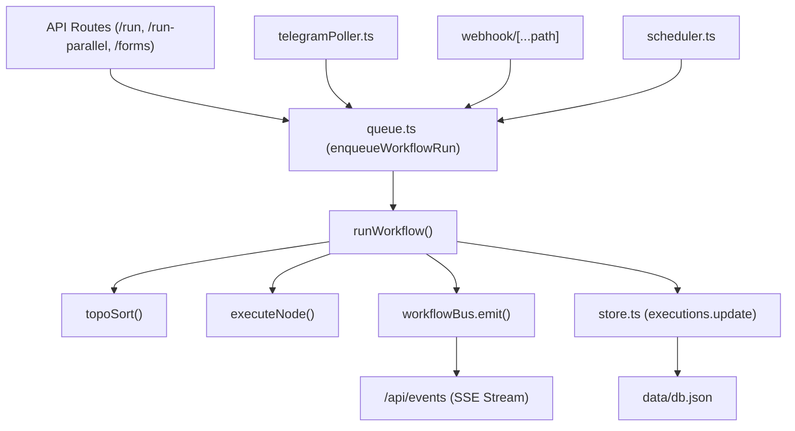

# FlowForge — Stage 2: Function Impact & Blast Radius Analysis

> **Scope**: Dependency mapping, caller/callee graphs, shared state evaluation, and risk blast radius assessment for all critical system functions in FlowForge.

---

## 1. System Function Dependency Matrix

| Function Name | Location | Callers | Direct Callees | Shared State | Blast Radius |
| :--- | :--- | :--- | :--- | :--- | :--- |
| `runWorkflow` | `src/lib/engine.ts:25` | `queue.ts`, `/api/forms/submit` | `topoSort`, `executeNode`, `workflowBus.emit`, `executions.create` | `executions` array in `db.json`, `workflowBus` | **CRITICAL** |
| `executeNode` | `src/lib/engine.ts:235`| `runWorkflow` | `EXECUTORS[type].run`, `resolveExpr` | Node input/output memory | **HIGH** |
| `resolveExpr` | `src/lib/expressions.ts:15` | `executeNode`, `executors.ts` | `node:vm` `Script.runInNewContext` | Context `$json`, `$secrets`, `$env` | **CRITICAL** |
| `enqueueWorkflowRun` | `src/lib/queue.ts:50` | `/api/workflows/[id]/run`, `telegramPoller.ts`, `/api/webhook` | `processNext` | `jobQueue` array, `activeWorkers` | **CRITICAL** |
| `processNext` | `src/lib/queue.ts:140`| `enqueueWorkflowRun`, job completion | `runWorkflow` | `jobQueue`, `completedJobs`, `activeWorkers` | **HIGH** |
| `triggerTelegramWorkflows` | `src/lib/telegramPoller.ts:115` | `pollUpdates` | `enqueueWorkflowRun`, `SESSION_CHATS` | In-memory `SESSION_CHATS` Map | **HIGH** |
| `read` / `write` | `src/lib/store.ts:95` | All `store.*` methods | `fs.readFileSync`, `fs.writeFileSync`, `renameSync` | `writeLock` Promise chain, `data/db.json` | **CRITICAL** |
| `syncExternalEnv` | `src/lib/store.ts:61` | `read` | `fs.readFileSync("D:/My n8n/.env")` | `secrets` memory dictionary | **MEDIUM** |
| `syncSchedules` | `src/lib/scheduler.ts:25`| `/api/workflows/[id]`, server init | `node-cron` `cron.schedule` | `ACTIVE_CRONS` Map | **HIGH** |
| `FlowForgeStudio` | `src/app/page.tsx:122` | Root Next.js page | All sub-handlers, ReactFlow, modals | 28 React useState hooks | **CRITICAL** |

---

## 2. In-Depth Blast Radius Profiling

### 2.1 `runWorkflow` (`src/lib/engine.ts`)

- **Blast Radius**: **CRITICAL (Level 5/5)**
- **Coupling Impact**: Any signature, return-type, or wave-scheduling modification to `runWorkflow` directly affects every trigger pathway in the system (Manual UI, Webhooks, Telegram Bot, Scheduled Crons, Form Submissions, and Parallel Wave Audits).
- **Safety Precaution**: Regression test suite must validate cycle-free execution, wave sequencing, item context isolation, and error propagation before touching this function.

---

### 2.2 `resolveExpr` (`src/lib/expressions.ts`)
- **Blast Radius**: **CRITICAL (Level 5/5)**
- **Coupling Impact**: Called by `executeNode` to evaluate all parameter fields across all 27 node types.
- **Vulnerabilities**:
  - If `resolveExpr` fails to catch a syntax error in user-entered `{{ ... }}`, the entire wave crashes unless wrapped in try/catch.
  - If `resolveExpr` allows prototype chain access, arbitrary code execution on the server host is possible.
- **Safety Precaution**: Must retain unit tests for primitive passthrough, nested object expression substitution, secret key interpolation, and prototype injection blocking.

---

### 2.3 `read` & `write` Mutex (`src/lib/store.ts`)
- **Blast Radius**: **CRITICAL (Level 5/5)**
- **Coupling Impact**: Controls persistence for workflows, execution history, database tables, and secrets.
- **Vulnerabilities**:
  - An uncaught exception inside the `writeLock` Promise chain permanently deadlocks all subsequent writes, requiring a server restart.
  - Synchronous reading blocks the Node.js event loop during heavy execution logging.
- **Safety Precaution**: Implement write timeouts, structured error handling, and test file-lock recovery.

---

### 2.4 `FlowForgeStudio` Client Root (`src/app/page.tsx`)
- **Blast Radius**: **HIGH (Level 4/5)**
- **Coupling Impact**: Monolithic React component managing 28 local state hooks. Modifying CSS or refactoring sub-components risks breaking:
  - ReactFlow node drag-and-drop and edge connections.
  - Live execution polling timer.
  - Sidebar accordion collapse states.
  - AI workflow builder modal state.
  - Telemetry dock tab selection.
- **Safety Precaution**: Isolate pure UI presentation into modular components (`Sidebar`, `HeaderBar`, `TelemetryDock`, `AIModal`) with strict props contracts.
